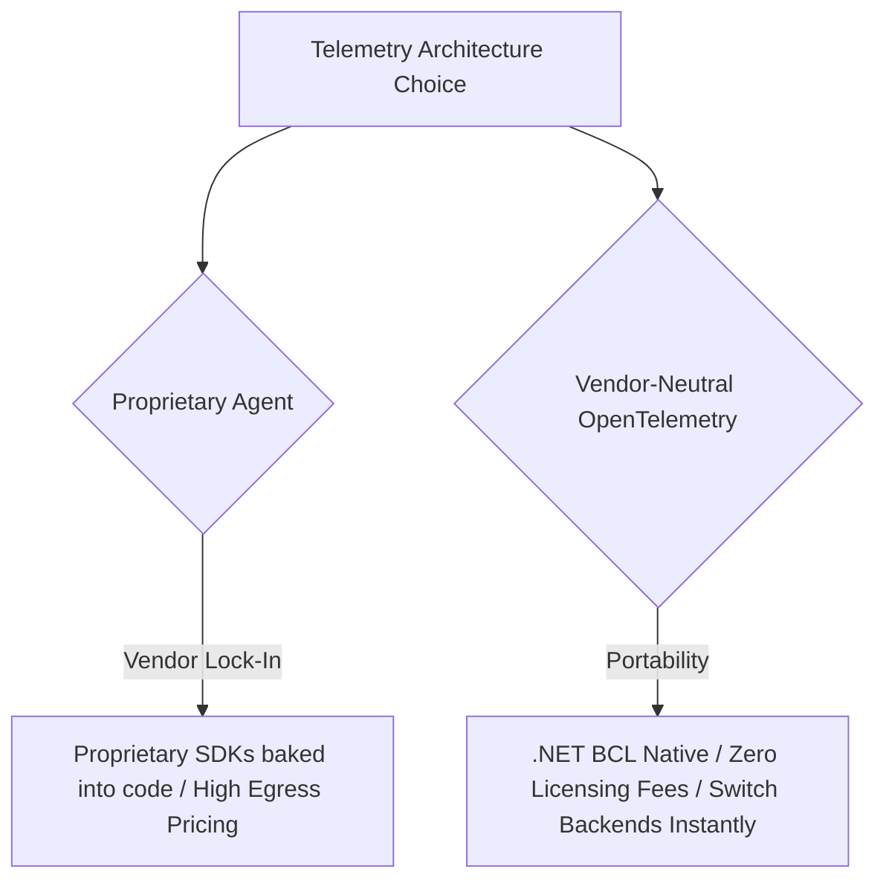

# Principal Observability Defense Scenarios

As a Principal Architect, you must defend telemetry architecture, sampling trade-offs, and SRE error budget policies in front of executive leadership (CTO, CFO, CISO), product managers, and engineering teams.

---

## Scenario 1: Defending OpenTelemetry Standards over Proprietary APM Agents

### The Challenge
> *"Our engineers are used to New Relic / Datadog agents. They just install the agent, and it auto-instruments everything with zero code. Why should we invest time writing OpenTelemetry code with ActivitySource and Meters?"*

### The Principal Defense

- **To the CFO**:  
  *"Proprietary APM agents lock us into single-vendor pricing models with punitive overage charges ($0.10 per custom metric, $5 per host/hour). By standardizing on OpenTelemetry, our instrumentation runs on native .NET BCL APIs (`System.Diagnostics`). We can route data to open-source backends (Prometheus, Tempo, Loki) or switch commercial vendors simply by updating a Collector YAML file—without changing a single line of application code or re-deploying microservices."*

- **To the Engineering Leads**:  
  *"Proprietary agents rely on aggressive runtime byte-code manipulation (profiler CLR hooks) that introduce unpredictable GC pauses, memory leaks, and version incompatibility during .NET upgrades. OpenTelemetry is built directly into the .NET 9 CLR. It is supported officially by Microsoft and CNCF, is zero-allocation on unsampled paths, and eliminates third-party agent instability."*

---

## Scenario 2: Defending Multi-Burn-Rate Alerting Against Raw CPU/Memory Alerts

### The Challenge
> *"Our DevOps team wants alerts when CPU exceeds 85% or Memory exceeds 80%. Why are you rejecting these alerts in favor of 'Multi-Window Burn Rates'?"*

### The Principal Defense
- **The Operational Reality (Alert Fatigue)**:  
  *"A CPU running at 90% is doing useful work. A modern multi-core server with thread pools and garbage collection can run at 92% CPU indefinitely while serving 100% of customer requests in under 50ms. Alerting on CPU causes on-call engineers to wake up at 3 AM for non-issues, leading to alert fatigue where real outages are ignored."*
- **The SRE Principle**:  
  *"Customers do not care about CPU percentage; customers care about availability and latency. Multi-Window Multi-Burn-Rate alerting fires exclusively when customer transactions are failing at a rate that threatens our contractual quarterly SLA. If CPU is at 99% and latency spikes to 3 seconds, the Latency SLO burn alert fires immediately. We alert on symptoms that impact revenue, not internal resource utilization."*

---

## Scenario 3: Defending Error Budget Deployment Freezes to Product Managers

### The Challenge
> *"The Product Manager complains: 'We have a critical marketing campaign launching tomorrow! Why is the CI/CD pipeline blocking our release just because the Error Budget reached 0%?'"*

### The Principal Defense
- **The Business Contract**:  
  *"The Error Budget is not an engineering rule; it is an agreed-upon executive business contract between Product, Engineering, and Customers. When the Error Budget hits 0%, it means we have already delivered more downtime and errors to our customers than we promised in our 99.9% commitment."*
- **The Risk Analysis**:  
  *"Deploying new features into an unstable system that has already exhausted its failure margin guarantees that the marketing campaign will fail publicly, destroying customer trust and brand reputation. The deployment freeze forces us to dedicate 100% of engineering velocity to fixing the underlying instability so that future marketing launches succeed on solid foundations."*

---

## Scenario 4: Defending Tail-Based Sampling over 100% Trace Ingestion

### The Challenge
> *"Our QA Lead insists: 'We must retain 100% of all traces in production. If we drop 90% of traces, we might miss a critical bug!'"*

### The Principal Defense
- **The Physical & Financial Math**:  
  *"At our scale of 40,000 requests/sec, 100% trace capture produces 1.5 Terabytes of JSON spans per hour—over 1 Petabyte per month. Ingesting and storing this volume would cost over $180,000/month in cloud storage fees, while saturating network interfaces."*
- **The Tail Sampling Solution**:  
  *"Tail sampling does not drop critical bugs. By holding traces in a 10-second ring buffer at the Collector gateway, we evaluate every trace after completion. If a trace contains an HTTP 5xx error, an unhandled exception, or a duration exceeding 500ms, our policy retains 100% of it. We only discard repetitive, successful 200 OK traces, keeping a 1% baseline for statistical comparisons. We capture every single production bug at 1/10th the infrastructure cost."*

---

## Additional Defense Scenarios Matrix

| Scenario | Opposing Argument | Principal Defense Stance |
|---|---|---|
| **5. High-Cardinality Tags** | "Let's put `user_id` on the HTTP metric so we can see which user had an error." | Metrics use inverted index posting lists. Putting unbounded IDs in tags causes exponential memory growth and crashes Prometheus. Put `user_id` in Span Attributes or Logs. |
| **6. AsyncLocal Tracing Overhead** | "Does `Activity.Current` flow slow down async methods?" | `AsyncLocal` context capture in .NET 9 is deeply optimized. The pointer swap cost is negligible (< 15ns), whereas distributed tracing provides multi-hop root cause discovery. |
| **7. PII Redaction at Edge** | "Why not let the storage backend mask PII during indexing?" | If unmasked PII hits the wire, it is already in violation of PCI-DSS and GDPR. Redaction must happen at the source application or local collector gateway. |
| **8. OpenTelemetry Exporter Protocol** | "Why use gRPC instead of HTTP/JSON for OTLP export?" | Protobuf over HTTP/2 gRPC provides binary serialization and multiplexed streaming, reducing telemetry CPU usage by 60% compared to JSON formatting. |
| **9. Single-Window Alerts** | "A 1-hour alert window is enough; why do we need two windows?" | A 1-hour window fires 55 minutes after a brief 5-minute transient spike has already healed. A short window (5m) confirms the incident is actively occurring. |
| **10. Tracing Health Checks** | "We should trace `/health` to know if our probes are working." | Health probes fire every 5 seconds across hundreds of pods, creating millions of junk spans that pollute APM traces and waste storage. Exclude them via middleware. |
| **11. Logging SQL Statements** | "Log all raw SQL queries with parameter values to debug data issues." | Logging raw SQL parameters leaks passwords, credit cards, and PII into log stores. Parameterized statements must be logged with values stripped or masked. |
| **12. Cloud APM vs Open-Source** | "Managed Datadog/NewRelic is easier than maintaining Prometheus/Grafana." | For small teams, managed is fine; at enterprise scale (millions of metrics), SaaS markups cost millions of dollars annually. Hybrid OTel allows us to control our destiny. |
| **13. Percentile Math (p99 vs Avg)** | "Average latency is 50ms, our performance is great!" | Averages hide tail outliers. 1% of users taking 10,000ms does not move a 50ms average, but it destroys conversion for high-volume enterprise transactions. |
| **14. Memory Limiter Dropping Data** | "The OTel Collector should never drop telemetry data." | If a collector runs out of memory, the process crashes, dropping 100% of data. Controlled load-shedding via `memory_limiter` drops 5% to save the remaining 95%. |
| **15. Structured Logging Enforcement** | "Developers should be able to write `logger.LogInformation("Done")` without ceremony." | Unstructured string logs prevent filtering and automated alerting. Compile-time source generators guarantee consistent schemas and eliminate heap allocations. |
