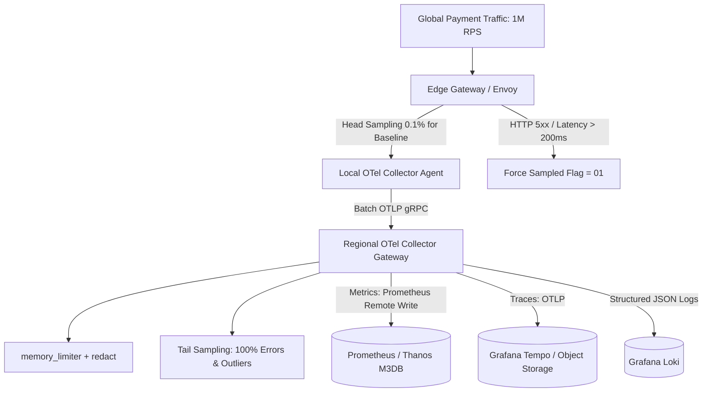

# Principal Observability Architect Interview Scenarios

These complex system scenarios assess deep telemetry reasoning, distributed tracing mechanics, failure triage under pressure, and cost modeling at the Staff and Principal Engineer levels.

---

## Scenario 1: Telemetry Architecture for a 1M RPS Global Payment Gateway

### The Prompt
> *"Architect a resilient, cost-governed observability platform for a global payment engine processing 1,000,000 requests per second across 3 continents. Total telemetry spend must not exceed $50,000/month, and all failures must be triaged within 3 minutes."*



### Key Architectural Solutions
1. **Hybrid Head and Tail Sampling**:
   - At 1M RPS, full trace capture is impossible ($10\text{ TB/day}$).
   - Root ingress evaluates: Normal requests are sampled at 0.1% (1 in 1,000).
   - Any transaction tagged as a failure, VIP customer, or latency outlier triggers a forced sample flag (`01`), guaranteeing 100% persistence.
2. **Cardinality Management**:
   - Strict rule: Zero transaction IDs or card numbers in metric labels.
   - Metrics are restricted to: `region`, `payment_method`, `provider`, `http_status_bucket`.
3. **Storage Tiering & FinOps**:
   - Traces stored in low-cost object storage (S3/GCS/Azure Blob) via Grafana Tempo, bypassing expensive SSD indexing.
   - Retention: 7 days hot, 30 days warm, then archived.

---

## Scenario 2: Debugging a Cascading Asynchronous Microservice Timeout with Zero Logs

### The Prompt
> *"A critical microservice pipeline (Service A -> Service Bus -> Service B -> Database) is timing out under peak load. Service B logs show nothing; Service A throws HTTP 504. How do you triage the root cause using distributed tracing and runtime metrics?"*

```mermaid
sequenceDiagram
    participant A as Service A (API)
    participant SB as Azure Service Bus Queue
    participant B as Service B (Worker)
    participant DB as SQL Database

    A->>SB: Enqueue Order (W3C traceparent in UserProperties)
    A-->>Client: 504 Gateway Timeout (Waited 10s)
    Note over SB: Message stays queued in SB partition!
    Note over B: Service B ThreadPool Starvation!\nWorker threads blocked on sync-over-async DB call!
    Note over B: B cannot dequeue messages; no log line ever reached!
```

### Triage Methodology
1. **Distributed Trace Context Inspection**:
   - Inspect the root trace in Tempo/Jaeger. The span for Service A shows message enqueued. The downstream child span in Service B was never started or is delayed by 8,000ms.
2. **USE Method Metric Analysis on Service B**:
   - **Queue Saturation**: Service Bus consumer lag metric (`servicebus.queue.messages_active`) is spiking.
   - **CLR ThreadPool Saturation**: Inspect `process.runtime.dotnet.threadpool.queue.length` on Service B. Queue length is 4,500; active threads pinned at max.
3. **Root Cause Discovery**:
   - Service B suffered ThreadPool starvation caused by sync-over-async calls (`.Result` on a database connection).
   - Because worker threads were deadlocked waiting for ThreadPool threads, Service B could not even execute the message handler to emit a log line!
   - Resolved by eliminating blocking `.GetAwaiter().GetResult()` and restoring async flow.

---

## Scenario 3: Migrating Legacy Monolithic Logging to Structured OpenTelemetry with Zero Allocation

### The Prompt
> *"A 10-year-old monolithic ASP.NET core service generates 400 GB of unstructured text logs daily, spending $35,000/month in Splunk. The GC spends 25% of CPU time in Gen 0 collections due to string formatting. How do you re-architect logging without stopping product development?"*

### The Migration Blueprint
1. **Step 1: Introduce `[LoggerMessage]` Source Generators**:
   - Ban raw `_logger.LogInformation($"...")` via Roslyn compiler analyzers (severity: Warning, then Error).
   - Provide automated refactoring templates to convert high-frequency log calls to strongly typed source-generated partial methods.
2. **Step 2: Swap Logging Backend to OTel LogBridge**:
   - Replace heavy third-party file log appenders with OpenTelemetry Protocol (OTLP) gRPC exporter.
   - Stream binary protobuf payloads directly to a local OTel Collector sidecar over unix domain sockets or loopback.
3. **Step 3: Index Pruning & Cost Reduction**:
   - Configure OTel Collector to drop debug-level logs at the edge.
   - Ingest structured logs into Grafana Loki or Elasticsearch with only bounded index labels, reducing log storage costs by 70%.

---

## Scenario 4: Multi-Tenant FinOps Observability Platform with Strict Tenant Isolation

### The Prompt
> *"Design a multi-tenant telemetry platform for a B2B SaaS system serving 5,000 enterprise tenants. Large tenants must not starve small tenants' metrics, and each tenant's telemetry consumption must be accurately billed back."*

### Key Enforcements
- **Tenant Metric Partitioning**: Metrics emitted include a bounded `tenant_tier` (`enterprise`, `pro`, `standard`).
- **Rate-Limiting Processor**: OTel Collector implements `rate_limiting` processor keyed by tenant ID extracted from OTLP headers. Any tenant attempting to emit > 10,000 spans/sec receives gRPC `ResourceExhausted`.
- **Telemetry Metering**: A dedicated counter (`telemetry.bytes.ingested`) aggregates bytes per tenant, exported to the billing engine for automated chargeback.

---

## Scenario 5: Disaster Recovery & Observability Resilience during Multi-Cloud Regional Partitions

### The Prompt
> *"During a catastrophic cloud region fiber cut, the primary cloud region loses internet connectivity. How do you ensure telemetry is preserved and cross-region alerts continue to function?"*

### Architectural Breakdown
- **Local Spillover Buffers**: OTel Collector agents configure disk-backed queue buffers (`file_storage` extension) on local NVMe drives. If outbound network connectivity to the central gateway is severed, spans buffer locally for up to 24 hours without dropping data.
- **Cross-Region Independent Alerting**: Each region runs its own localized Prometheus and Alertmanager instance. Alerting decisions are made locally within the region without requiring cross-region RPCs.
- **Global Anycast Ingestion**: Global edge collectors synchronize status via lightweight DNS heartbeats; upon network restoration, buffered disk queues drain asynchronously with rate-limited catchup.
