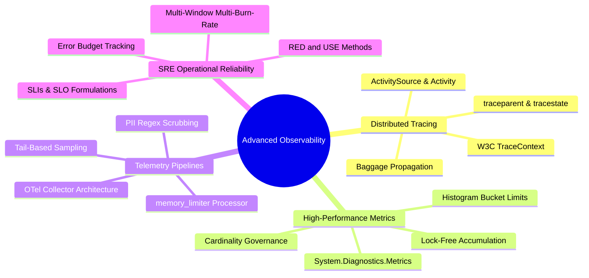
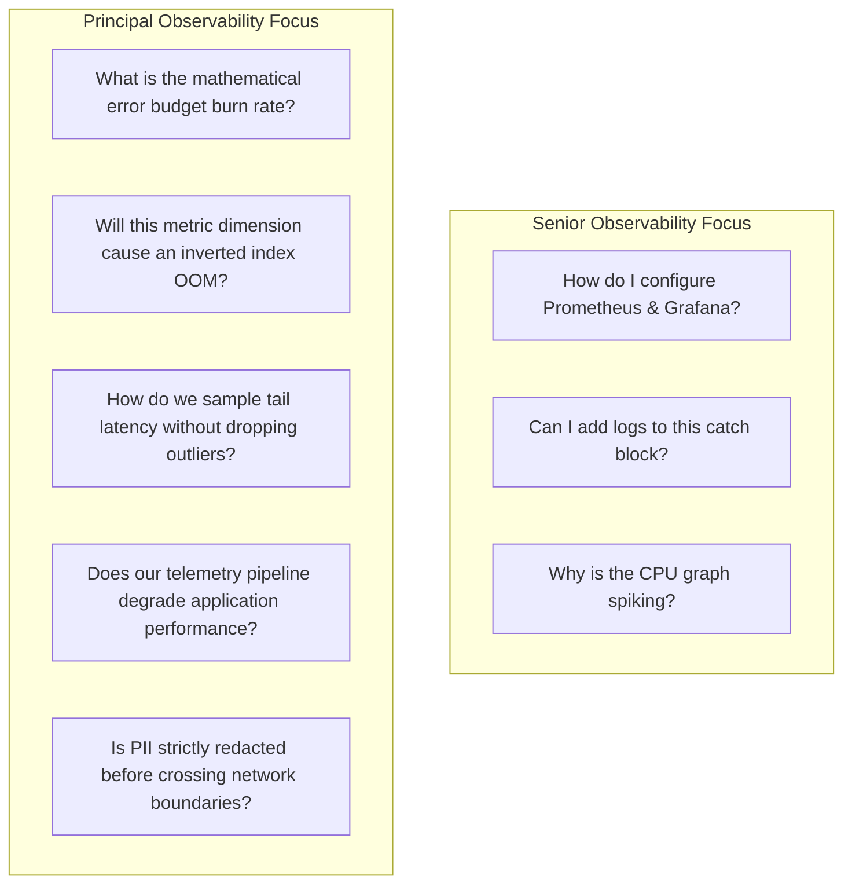

# Sprint 09 Summary: Advanced Observability & Telemetry

Sprint 09 establishes the definitive engineering standards for enterprise observability, telemetry pipelines, and Google SRE reliability operations.

---

## Core Architectural Pillars Covered

---

## Architectural Decision Cheat Sheet

| Architectural Decision | Choose This | Avoid This | Rationale |
|---|---|---|---|
| **Instrumentation API** | .NET BCL `System.Diagnostics.*` | Proprietary vendor SDKs | Built natively into the CLR; zero vendor lock-in; zero allocations on unsampled paths. |
| **Distributed Context** | Standard W3C TraceContext | Custom proprietary headers | Universal interoperability across HTTP, gRPC, and messaging brokers. |
| **Trace Sampling** | Tail-Based Sampling at Gateway | 100% Full Ingestion | Captures 100% of failures and latency outliers while reducing storage costs by 80-90%. |
| **Metric Dimensions** | Bounded low cardinality ($< 50$) | High-cardinality IDs (UUIDs) | Protects TSDB inverted index from memory exhaustion and crash loops. |
| **Logging Engine** | `[LoggerMessage]` Source Generators | String interpolation (`$"..."`) | Eliminates heap allocations and boxing on the critical request hot path. |
| **Alerting Discipline** | Multi-Window Multi-Burn-Rate | Static threshold alerts (CPU > 80%) | Eliminates alert fatigue; pages exclusively when customer SLO error budgets are threatened. |
| **Dashboard Design** | RED & USE Method + Exemplars | 50-panel uncoordinated dashboards | Reduces cognitive overload during SEV-1 incidents; links metrics directly to traces. |

---

## What Distinguishes a Senior from a Principal Observability Architect

A Senior Engineer monitors the system to see if it is running.  
A **Principal Architect** designs an observability platform that allows any engineer to understand unknown system states, enforces mathematically sound reliability contracts (SLOs), and protects the enterprise from financial and operational failure.
