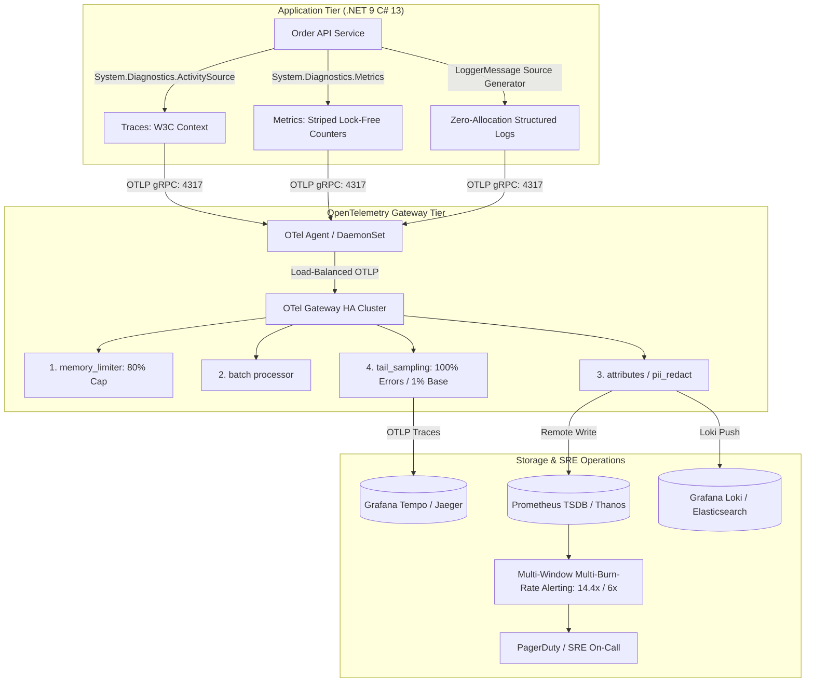

# Sprint 09: Advanced Observability & Telemetry

Welcome to **Sprint 09** of the Principal Engineer Journey. This module is an authoritative, master-level exploration of enterprise observability, OpenTelemetry runtime internals, W3C distributed tracing, high-cardinality data engineering, and Google SRE reliability operations.

---

## Chapter Directory

| # | Chapter Document | Core Themes & Technologies |
|---|---|---|
| **01** | [`01-Story.md`](01-Story.md) | SEV-1 Incident: The $90k Cardinality Explosion & The Silent Microservice Outage |
| **02** | [`02-Learning-Objectives.md`](02-Learning-Objectives.md) | Bloom's Taxonomy & Principal Competencies across Observability Pillars |
| **03** | [`03-Observability-Requirements.md`](03-Observability-Requirements.md) | Telemetry Budgeting, SLO Guarantees, Cardinality Budgets & Sampling Math |
| **04** | [`04-Observability-Architecture.md`](04-Observability-Architecture.md) | Enterprise Telemetry Topology: Agent vs Gateway, OTLP Collector Clusters |
| **05** | [`05-OpenTelemetry-Core-SDK.md`](05-OpenTelemetry-Core-SDK.md) | .NET 9 OpenTelemetry SDK Architecture, TracerProvider & Resource Detectors |
| **05A**| [`05A-Inside-DiagnosticSource-And-Activity-Internals.md`](05A-Inside-DiagnosticSource-And-Activity-Internals.md) | CLR Internals: `DiagnosticSource`, `ActivitySource`, `Activity`, AsyncLocal Flow |
| **06** | [`06-Distributed-Tracing-W3C-Context.md`](06-Distributed-Tracing-W3C-Context.md) | W3C TraceContext (`traceparent`, `tracestate`), Baggage & Header Propagation |
| **06A**| [`06A-Inside-Metrics-And-Aggregation-Internals.md`](06A-Inside-Metrics-And-Aggregation-Internals.md) | CLR Internals: `Meter`, Counter/Histogram Buckets & Lock-Free Striping |
| **07** | [`07-Structured-Logging-And-High-Performance-Pipelines.md`](07-Structured-Logging-And-High-Performance-Pipelines.md) | `[LoggerMessage]` Source Generators, Zero-Allocation Formatters & PII Masking |
| **08** | [`08-OTel-Collector-Architecture-And-Pipelines.md`](08-OTel-Collector-Architecture-And-Pipelines.md) | OTel Collector Internals: Receivers, Processors, Exporters & Collector HA |
| **09** | [`09-High-Cardinality-And-Telemetry-Cost-Engineering.md`](09-High-Cardinality-And-Telemetry-Cost-Engineering.md) | Inverted Index Explosion, TSDB Posting Lists, Tail Sampling & Telemetry FinOps |
| **10** | [`10-SLIs-SLOs-And-Error-Budget-Engineering.md`](10-SLIs-SLOs-And-Error-Budget-Engineering.md) | Google SRE Math: Valid vs Good Events, Error Budget Tracking & Freeze Policies |
| **11** | [`11-Multi-Window-Multi-Burn-Rate-Alerting.md`](11-Multi-Window-Multi-Burn-Rate-Alerting.md) | Multi-Window Multi-Burn-Rate Architecture: 14.4x/6x/1x Rates & PromQL Rules |
| **12** | [`12-Grafana-Dashboard-Architecture-And-Visualization.md`](12-Grafana-Dashboard-Architecture-And-Visualization.md) | Dashboard Design: USE vs RED Methods, Heatmaps, Exemplar-to-Trace Navigation |
| **13** | [`13-Principal-Observability-Checklist.md`](13-Principal-Observability-Checklist.md) | Principal Observability Production Readiness Review (PRR) Checklist |
| **14** | [`14-Hands-On-Observability-Labs.md`](14-Hands-On-Observability-Labs.md) | 5 Production Labs: .NET 9 OTel, Custom ActivitySource, Tail Sampling, PromQL |
| **15** | [`15-Production-Incident-Post-Mortem.md`](15-Production-Incident-Post-Mortem.md) | SEV-1 Post-Mortem: The UUID-in-Metric-Tag Memory Outage & Monitoring Blackout |
| **16** | [`16-Principal-Observability-Defense-Questions.md`](16-Principal-Observability-Defense-Questions.md) | 15 Deep Defense Scenarios for CTO, CFO, CISO & SRE Review Boards |
| **17** | [`17-Principal-Observability-Interview-Scenarios.md`](17-Principal-Observability-Interview-Scenarios.md) | 5 Staff/Principal Observability & Telemetry Architecture Case Studies |
| **18** | [`18-Summary.md`](18-Summary.md) | Executive Summary & Architectural Synthesis: Senior vs Principal Mindset |
| **19** | [`19-Resources.md`](19-Resources.md) | Curated Official References, Standards (W3C, OTel Spec, Google SRE) |
| **README** | [`README.md`](README.md) | Sprint 09 Visual Architecture Topology Map & Chapter Navigation Matrix |

---

## Key Architectural Principles

1. **Vendor-Neutral by Default**: Standardize instrumentation on open standards (W3C TraceContext, OpenTelemetry, .NET BCL `System.Diagnostics`).
2. **Cardinality Discipline**: Keep metric label dimensions bounded ($|L| \le 50$). High-cardinality attributes belong exclusively in distributed traces and structured logs.
3. **Tail-Based Quality**: Use intelligent tail-based sampling at the collector gateway to preserve 100% of errors and latency anomalies while discarding repetitive healthy traces.
4. **Reliability Driven by Math**: Eliminate arbitrary CPU/memory threshold alerts. Alert on customer-impacting Service Level Objective (SLO) Multi-Window Multi-Burn-Rates.
5. **Zero Allocation on Hot Paths**: Utilize C# `[LoggerMessage]` source generators and native CLR fast-path checks (`HasListeners()`) to eliminate telemetry-induced GC pressure.
