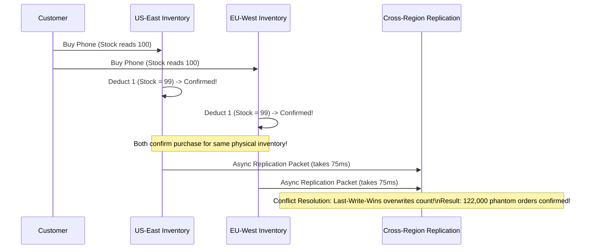

# The Incident: The Flash-Sale Collapse & The $12M Split-Brain Inventory Oversell

On October 14, 2026, at precisely 00:00:01 UTC, OmniRetail launched the global flash sale for the year's most anticipated flagship smartphone. Exactly 20,000 units were in stock across regional fulfillment centers. The marketing campaign had generated over 15 million pre-registrations.

Within 4 seconds of opening the digital floodgates, the platform was hit by **180,000 requests per second**.

Nine minutes later, the company had sold **142,000 units** of a product with only 20,000 physical units in existence—resulting in an immediate $12.2 million oversell liability, a catastrophic database lock collapse, and a public PR disaster.

---

## 1. The Anatomy of the Meltdown

The application had been designed with an active-active multi-region deployment across US-East and EU-West, backed by what the team believed was an enterprise distributed database with multi-master replication.

```mermaid
flowchart TD
    subgraph RegionEast ["US-East Region (90k RPS)"]
        ClientUS[US Buyers] --> APIM_US[API Gateway]
        APIM_US --> Svc_US[Inventory Service US]
        Svc_US --> Cache_US[(Local Redis: Stock = 20,000)]
        Cache_US --> DB_US[(Postgres US: Master)]
    end

    subgraph RegionWest ["EU-West Region (90k RPS)"]
        ClientEU[EU Buyers] --> APIM_EU[API Gateway]
        APIM_EU --> Svc_EU[Inventory Service EU]
        Svc_EU --> Cache_EU[(Local Redis: Stock = 20,000)]
        Cache_EU --> DB_EU[(Postgres EU: Master)]
    end

    DB_US <-->|Async Cross-Atlantic Replication (75ms RTT)| DB_EU
    Note over DB_US,DB_EU: 75ms replication lag allowed both regions to deduct stock simultaneously!
```

### The Fatal Flaws
1. **The Asynchronous Multi-Master Trap**:  
   Both US-East and EU-West maintained a local database master with asynchronous cross-region replication. Because cross-Atlantic network round-trip time (RTT) was ~75ms, each region continued deducting from its local inventory counter `stock = stock - 1`. During the 75ms replication window, each region sold 15,000 units before receiving the first replication update from the other side.
2. **The Cache Stampede (Dogpiling)**:  
   When the Redis cache key `inventory:flagship-phone` expired after its 60-second TTL at 00:01:00 UTC, 45,000 concurrent threads simultaneously discovered a cache miss and fired SQL queries directly at the primary relational database:
   ```sql
   SELECT stock_count FROM inventory WHERE sku = 'PHONE-XYZ-2026' FOR UPDATE;
   ```
3. **Database Thread Pool & Connection Starvation**:  
   The relational database connection pool (max 500 connections) was exhausted in 80 milliseconds. The remaining 44,500 requests queued up, locking OS thread handles. Database CPU surged to 100%, memory pagination thrashed, and PostgreSQL began dropping socket connections with `FATAL: remaining connection slots are reserved for non-replication superuser connections`.
4. **Cascading Upstream Collapse**:  
   As database queries stalled, upstream API Gateway thread pools backed up. Ingress proxies ran out of ephemeral TCP ports and began returning HTTP 504 Gateway Timeout and HTTP 502 Bad Gateway to all incoming customers.

---

## 2. The Fallout & The $12,200,000 Liability



By the time the engineering team manually injected an emergency iptables firewall block at 00:09:15 UTC, the damage was done:
- **Physical Stock Available**: 20,000 units
- **Confirmed Orders**: 142,000 units
- **Unfulfillable Orders**: 122,000 units
- **Financial Exposure**: At $1,000 per unit, fulfilling the oversold orders via emergency spot market procurement incurred a **$12,200,000 loss**, coupled with $50 promotional vouchers issued to appease furious customers.

---

## 3. The Principal Architect's Perspective

The team did not fail because their code had syntax errors. They failed because their **system design violated the fundamental laws of distributed physics**:
- They assumed they could have **Active-Active multi-region writes** on a single shared balance without paying the latency penalty of distributed consensus (violating the PACELC theorem).
- They allowed **high-concurrency read-write hot spots** on a single database row (`sku = 'PHONE-XYZ-2026'`), creating unresolvable lock contention.
- They lacked **tokenized queue-based admission control**, exposing downstream relational databases directly to raw internet traffic spikes.
- They had no **probabilistic early cache refresh** (XFetch) or single-flight mutexes to prevent dogpiling upon cache expiration.

A Principal Systems Architect does not hope for the best during peak traffic; they mathematically prove capacity limits, partition workloads along physical boundaries, isolate hot keys, and design failure-safe admission gates.
