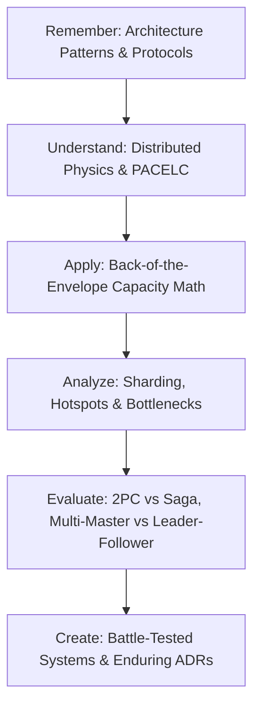

# Learning Objectives & Principal System Design Competencies

System design at the Staff and Principal Engineer level is not about memorizing buzzwords (e.g., "put Kafka here, put Redis there"). It is the rigorous discipline of evaluating trade-offs, calculating capacity bounds, bounding failure domains, and ensuring business invariants hold under extreme load.

---

## 1. Bloom's Taxonomy: System Design Competencies

### Level 1: Remember & Recall
- Define key architectural components: Load Balancers (L4 vs L7), Reverse Proxies, CDN Edge, Message Brokers, and Inverted Indices.
- Recall standard sharding methodologies: Range-based, Hash-based, and Directory-based partitioning.
- State standard distributed consensus and replication terms: Quorum, Leader Election, WAL, Split-Brain, and Merkle Trees.

### Level 2: Understand & Explain
- Explain how the PACELC theorem dictates system behavior during network partitions and steady-state execution.
- Contrast Two-Phase Commit (2PC) blocking locks with Sagas and the Outbox pattern.
- Articulate the physical causes of cache dogpiling and how consistent hashing with virtual nodes eliminates cascading re-sharding storms.

### Level 3: Apply & Implement
- Perform precise back-of-the-envelope calculations for RPS, network egress (Gbps), storage volume (TB/year), and memory sizing.
- Architect high-throughput rate limiters using sliding-window counter algorithms backed by atomic Redis Lua scripts.
- Formulate idempotent consumer workflows backed by relational Inbox deduplication tables.

### Level 4: Analyze & Diagnose
- Deconstruct high-concurrency database hot spots (e.g., inventory counters, celebrity users) and apply sharded counters or reservation tokens.
- Analyze replication lag, read-after-write consistency anomalies, and split-brain scenarios in distributed datastores.
- Identify single points of failure (SPOF) across DNS, network gateways, secret stores, and cloud regions.

### Level 5: Evaluate & Justify
- Defend architectural decisions (e.g., choosing single-master active-passive over multi-master active-active for inventory balance).
- Evaluate trade-offs between strong consistency (CP) and high availability (AP) under contractual SLA constraints.
- Justify architectural cost efficiency: compute right-sizing, storage tiering, and egress fee mitigation.

### Level 6: Create & Govern
- Design end-to-end, multi-region distributed architectures handling 100k+ RPS with sub-second latency and zero data loss.
- Author definitive Architecture Decision Records (ADRs) that clearly articulate context, decision drivers, consequences, and rejected alternatives.
- Lead Architecture Review Boards (ARBs) to evaluate RFCs and govern technical debt across enterprise engineering teams.

---

## 2. Senior vs. Principal System Designer Mindset

| Dimension | Senior Engineer Focus | Principal Architect Focus |
|---|---|---|
| **Approach** | Starts drawing boxes and lines immediately (Load Balancer -> App -> DB). | Clarifies functional and non-functional requirements, traffic scale, read/write ratios, and consistency invariants first. |
| **Capacity** | "We will use auto-scaling in the cloud." | Calculates back-of-the-envelope RPS, memory footprints, IOPS limits, and network bandwidth boundaries upfront. |
| **Data Strategy** | "We will put everything in MongoDB or PostgreSQL." | Selects datastores based on access patterns: relational for transactional ACID, document for flexible entities, columnar for analytics, time-series for telemetry. |
| **Consistency** | Assumes distributed writes are atomic and instantaneous. | Identifies replication lag, plans for network partitions, and uses Sagas, Outbox, or CRDTs for convergence. |
| **Failure Modes** | Focuses on the happy path; considers crashes an edge case. | Designs for catastrophic partial failure: circuit breakers, fallback degradation, rate limiting, and automated failover drills. |
