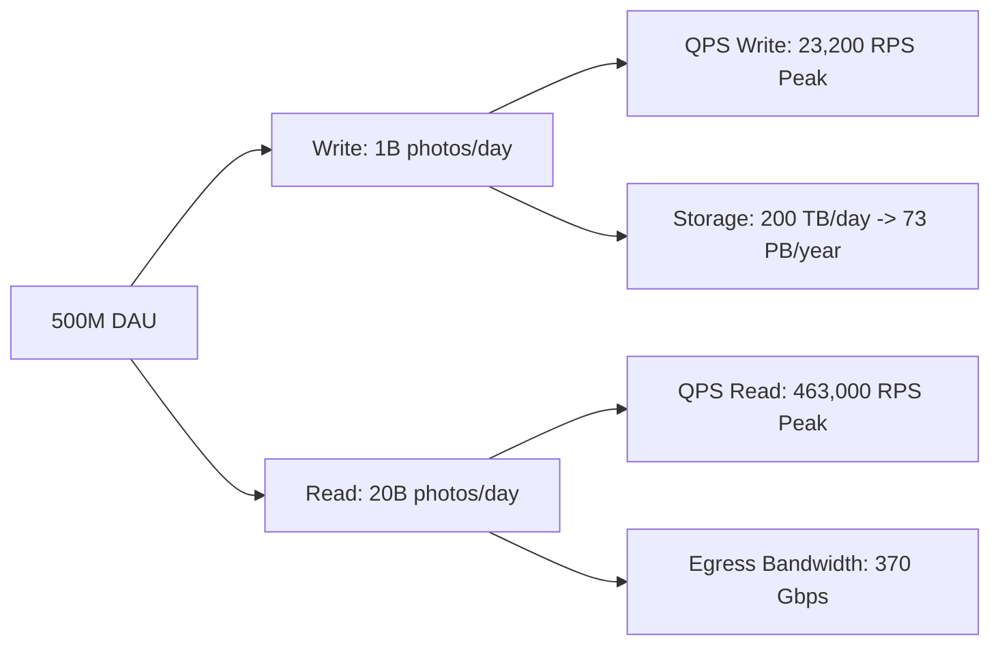

# Back-of-the-Envelope Capacity Estimation & SLA Mathematics

A Principal Engineer never designs a system in a vacuum. Before selecting databases, message queues, or server sizes, you must perform mathematical estimations to determine whether the architecture is physically viable.

---

## 1. The Numbers Every Architect Must Know

To perform rapid estimations, memorize these fundamental hardware and network orders of magnitude:

| Operation | Latency | Real-World Intuition |
|---|---|---|
| **L1 CPU Cache Reference** | $0.5\text{ ns}$ | 1 heartbeat |
| **L2 CPU Cache Reference** | $7\text{ ns}$ | 14 heartbeats |
| **Main Memory (RAM) Reference** | $100\text{ ns}$ | 200 heartbeats |
| **SSD / NVMe Random Read** | $100\text{ }\mu\text{s}$ (0.1ms) | 200,000 heartbeats |
| **Round Trip within Same Datacenter** | $500\text{ }\mu\text{s}$ (0.5ms) | 1,000,000 heartbeats |
| **Standard HDD Disk Seek** | $10\text{ ms}$ | 20,000,000 heartbeats |
| **Cross-Continent Round Trip (NY to London)** | $75\text{ ms}$ | 150,000,000 heartbeats |
| **Trans-Pacific Round Trip (SF to Tokyo)** | $150\text{ ms}$ | 300,000,000 heartbeats |

### Useful Math Conversions
- $1\text{ day} = 86,400\text{ seconds} \approx 10^5\text{ seconds}$ (conservative approximation: $8.64 \times 10^4$).
- $1\text{ million requests/day} \approx 12\text{ requests/sec}$ ($10^6 / 86,400$).
- $1\text{ billion requests/day} \approx 11,600\text{ requests/sec}$.
- $1\text{ Byte} \rightarrow 1\text{ KB} (10^3) \rightarrow 1\text{ MB} (10^6) \rightarrow 1\text{ GB} (10^9) \rightarrow 1\text{ TB} (10^{12}) \rightarrow 1\text{ PB} (10^{15})$.

---

## 2. Step-by-Step Capacity Estimation Template

Let us calculate capacity for a global social photo sharing platform (similar to Instagram):
- **Active Users**: 500,000,000 Daily Active Users (DAU).
- **Post Frequency**: Each user views 40 photos and uploads 2 photos per day.
- **Payload Size**: Average photo size is $200\text{ KB}$; metadata payload is $500\text{ Bytes}$.

### Step 1: Throughput (RPS / QPS)
$$\text{Writes/day} = 500\text{M} \times 2 = 1,000,000,000\text{ photos/day}$$
$$\text{Average Write QPS} = \frac{1,000,000,000}{86,400} \approx 11,600\text{ writes/sec}$$
$$\text{Peak Write QPS} = 11,600 \times 2 = 23,200\text{ writes/sec}$$

$$\text{Reads/day} = 500\text{M} \times 40 = 20,000,000,000\text{ reads/day}$$
$$\text{Average Read QPS} = \frac{20,000,000,000}{86,400} \approx 231,500\text{ reads/sec}$$
$$\text{Peak Read QPS} = 231,500 \times 2 = 463,000\text{ reads/sec}$$

### Step 2: Storage Sizing (Capacity & Retention)
$$\text{Daily Media Storage} = 1,000,000,000 \times 200\text{ KB} = 200,000,000,000\text{ KB} = 200\text{ TB/day}$$
$$\text{Annual Media Storage} = 200\text{ TB/day} \times 365 \approx 73,000\text{ TB} = 73\text{ PB/year}$$
$$\text{Daily Metadata Storage} = 1,000,000,000 \times 500\text{ Bytes} = 500\text{ GB/day}$$

### Step 3: Network Bandwidth (Ingress & Egress)
$$\text{Ingress Bandwidth} = 11,600\text{ writes/sec} \times 200\text{ KB} = 2.32\text{ GB/sec} = 18.56\text{ Gbps}$$
$$\text{Egress Bandwidth} = 231,500\text{ reads/sec} \times 200\text{ KB} = 46.3\text{ GB/sec} = 370.4\text{ Gbps}$$

### Step 4: Memory Cache Sizing (The 80/20 Pareto Rule)
Assume 20% of photos generate 80% of daily read traffic. We cache that 20% of daily read media in Redis / CDN:
$$\text{Daily Read Media} = 20\text{B reads} \times 200\text{ KB} \text{ (unique fraction)}$$
If $20\%$ of daily uploaded photos are hot:
$$\text{Cache RAM} = 200\text{ TB/day} \times 0.20 = 40\text{ TB of RAM}$$
At 64 GB per Redis node:
$$\text{Redis Nodes Required} = \frac{40,000\text{ GB}}{64\text{ GB}} \approx 625\text{ Redis cache nodes}$$

---

## 3. Composite SLA Calculations

When systems depend on multiple components, availability multiplies:

$$\text{SLA}_{\text{Serial}} = \prod_{i=1}^N \text{SLA}_i$$

$$\text{SLA}_{\text{Parallel / Redundant}} = 1 - \prod_{i=1}^N (1 - \text{SLA}_i)$$

### Example: The Fragility of Deep Stacks
If an API Gateway ($99.95\%$) calls an Auth Service ($99.9\%$) which queries a Cache ($99.9\%$) which queries a Database ($99.9\%$):
$$\text{SLA}_{\text{Total}} = 0.9995 \times 0.999 \times 0.999 \times 0.999 = 0.9965 \quad (99.65\%)$$
Downtime increases from 21.6 minutes/month to **2.5 hours/month**! To reach $99.99\%$, fallback paths, regional redundancy, and graceful degradation are mathematically required.
