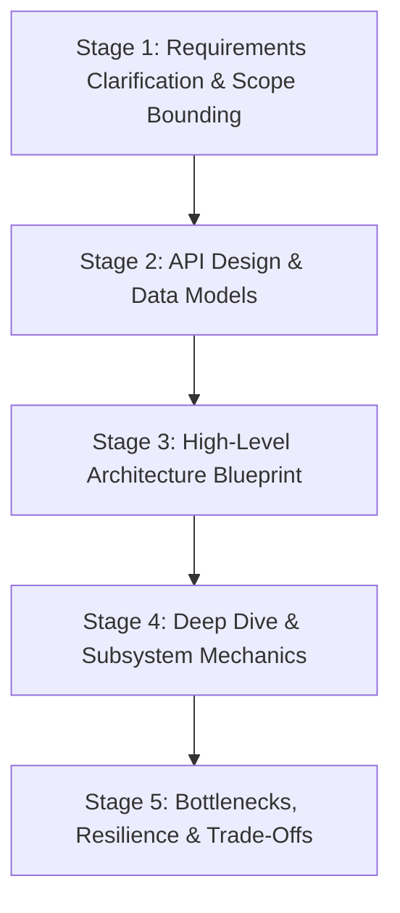
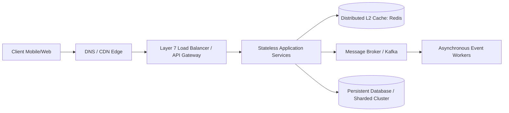

# The Principal 5-Stage System Design Framework

System design interviews and production RFCs fail when engineers dive prematurely into low-level implementation details without establishing requirements, bounds, and interfaces.

A Principal Architect executes the **5-Stage System Design Framework**.

---

## The 5-Stage System Design Lifecycle



---

## Stage 1: Requirements Clarification & Scope Bounding (15% of Time)
Never accept an ambiguous prompt (e.g., "Design Twitter"). Deconstruct it into explicit boundaries:

### 1. Functional Requirements (Core Features)
- What are the top 3 core user journeys? (e.g., Post tweet, View user timeline, View home timeline).
- What is explicitly out of scope? (e.g., Direct messages, ads, video streaming).

### 2. Non-Functional Requirements (System Invariants)
- **Scale**: Daily Active Users (DAU), read-to-write ratio, peak traffic multipliers.
- **Latency**: p95/p99 read latency target (e.g., $< 100\text{ms}$), write latency (e.g., $< 500\text{ms}$).
- **Consistency vs Availability**: Is this a CP or AP system? (e.g., Social feeds tolerate eventual consistency; banking ledgers demand strong consistency).
- **Durability & RPO/RTO**: Can data be lost during regional failure? What is the acceptable recovery window?

---

## Stage 2: Interface Contracts & Data Models (15% of Time)

Before drawing components, define the communication contracts:

### 1. REST / gRPC API Contracts
```protobuf
// High-performance gRPC protobuf definition
syntax = "proto3";

service OrderService {
  rpc SubmitOrder (SubmitOrderRequest) returns (SubmitOrderResponse);
  rpc GetOrderStatus (GetOrderStatusRequest) returns (GetOrderStatusResponse);
}

message SubmitOrderRequest {
  string idempotency_key = 1;
  string customer_id = 2;
  repeated OrderItem items = 3;
}
```

### 2. Core Data Entities
- Identify primary entities (e.g., `User`, `Tweet`, `Follower`).
- Define relationship mapping: Relational schema with foreign keys vs NoSQL Document / Key-Value schema.
- Select partition keys: What is the distribution key for sharding?

---

## Stage 3: High-Level Architecture Blueprint (20% of Time)

Construct the end-to-end data flow from client to persistent storage:



---

## Stage 4: Component Deep Dives & Mechanics (35% of Time)

Drill into the hardest architectural problems identified in the prompt:
- **Hot-Key Isolation**: How do we handle a celebrity user with 80 million followers without burning Redis CPU?
- **Data Fan-Out**: Fan-out on write (push to all follower timelines) vs Fan-out on read (pull and merge on demand).
- **Idempotency**: How does the payment gateway guarantee an order is billed exactly once despite client retries?

---

## Stage 5: Bottlenecks, Resilience & Trade-Offs (15% of Time)

Validate the design under stress:
- **Failure Analysis**: What happens when the primary database crashes? What happens during a cross-region fiber cut?
- **Rate Limiting & Shedding**: Where do we place token bucket rate limiters to protect backend services?
- **Trade-Off Justification**: Defend why you chose PostgreSQL over Cassandra, or Kafka over RabbitMQ.
