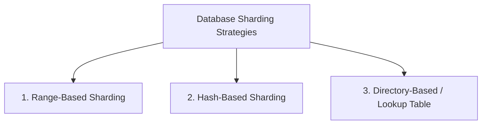
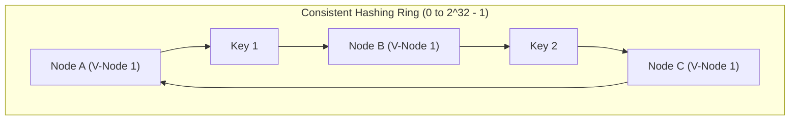
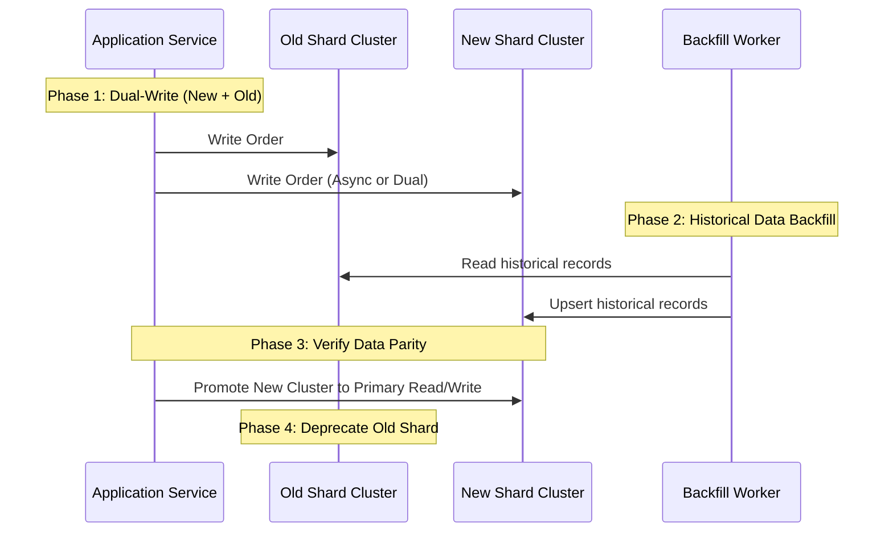

# Database Partitioning & Sharding Architecture

When a single database node exceeds its physical capacity limits (RAM, disk I/O, or connection handles), horizontal database sharding becomes mandatory.

---

## 1. Sharding Methodologies Compared



### 1. Range-Based Sharding
- **Mechanism**: Rows are routed based on contiguous ranges of a key (e.g., Shard 1: `A-F`, Shard 2: `G-M`, Shard 3: `N-Z`, or timestamps by month).
- **Advantage**: Efficient range queries (`SELECT * WHERE date BETWEEN ...`).
- **Fatal Flaw**: **Severe Hotspots**. Storing time-series data by date directs 100% of current write traffic to the latest shard, leaving older shards idle.

### 2. Hash-Based Sharding
- **Mechanism**: Shard ID is computed via a deterministic hash function: $\text{ShardID} = \text{Hash}(K) \pmod N$.
- **Advantage**: Uniform, even distribution of writes across all $N$ shards.
- **Fatal Flaw**: Adding or removing a shard alters $N$, requiring a massive re-sharding migration of almost all existing keys.

### 3. Consistent Hashing with Virtual Nodes
Consistent hashing solves the re-sharding dilemma by mapping both nodes and keys onto a circular hash ring ($[0, 2^{32}-1]$).



- When a new database node is added, only $\frac{1}{N}$ of keys are migrated.
- **Virtual Nodes (V-Nodes)**: Each physical machine is mapped to 100-256 virtual points on the ring, preventing non-uniform data skew.

---

## 2. Production Sharded Router Implementation in C# (.NET 9)

```csharp
using System.Security.Cryptography;
using System.Text;

namespace Enterprise.SystemDesign.Sharding;

public class ConsistentHashRouter<TNode>
{
    private readonly SortedDictionary<uint, TNode> _ring = new();
    private readonly int _virtualNodes;

    public ConsistentHashRouter(IEnumerable<TNode> nodes, int virtualNodes = 150)
    {
        _virtualNodes = virtualNodes;
        foreach (var node in nodes)
        {
            AddNode(node);
        }
    }

    public void AddNode(TNode node)
    {
        for (int i = 0; i < _virtualNodes; i++)
        {
            var vNodeKey = $"{node?.ToString()}-VNODE-{i}";
            var hash = ComputeHash(vNodeKey);
            _ring[hash] = node!;
        }
    }

    public TNode GetNode(string key)
    {
        if (_ring.Count == 0) throw new InvalidOperationException("Hash ring is empty.");

        var hash = ComputeHash(key);
        
        // Find first node on ring with hash >= key hash
        foreach (var kvp in _ring)
        {
            if (kvp.Key >= hash)
            {
                return kvp.Value;
            }
        }

        // Wrap around to beginning of ring
        return _ring.First().Value;
    }

    private static uint ComputeHash(string input)
    {
        var bytes = SHA256.HashData(Encoding.UTF8.GetBytes(input));
        return BitConverter.ToUInt32(bytes, 0);
    }
}
```

---

## 3. Zero-Downtime Re-sharding Strategy (Dual-Writing)

Migrating data from $N$ to $2N$ shards in production must be accomplished without service interruption.


