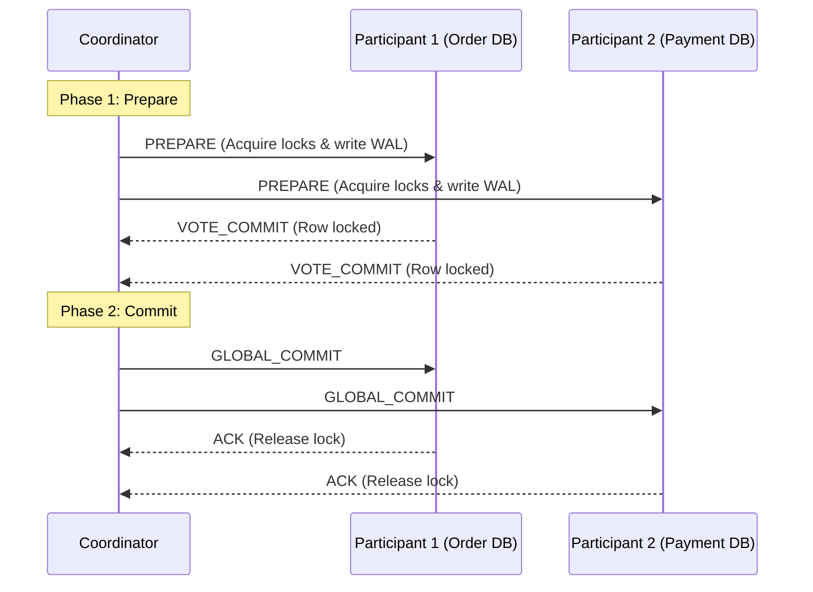
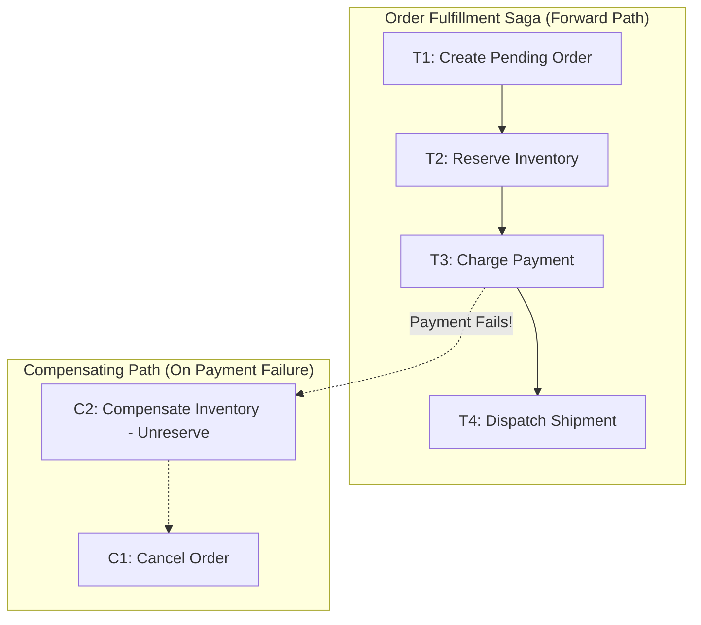

# Distributed Transactions: Two-Phase Commit (2PC) vs. Saga Orchestration

When a business transaction spans multiple partitioned databases or microservices, traditional single-node ACID transactions are physically impossible.

---

## 1. Why Two-Phase Commit (2PC / XA) Fails at Scale

The Two-Phase Commit (2PC) protocol guarantees atomicity across distributed databases:

### The 3 Fatal Failure Modes of 2PC
1. **The Blocking Lock Trap**:  
   During the window between Phase 1 (Prepare) and Phase 2 (Commit), all participant databases hold exclusive database row locks. If the Coordinator crashes or network packets are delayed, those locks are held indefinitely, locking out other transactions and bringing throughput to zero.
2. **Availability Degradation ($O(N)$ Failure Multiplier)**:  
   If any single participant node is unavailable or partitioned, the entire global transaction must abort. As the number of microservices $N$ grows, the probability of transaction failure approaches 100%.
3. **No Cross-Cloud / Heterogeneous Support**:  
   Modern cloud services (Stripe, Twilio, third-party logistics) do not support XA/2PC transactions.

---

## 2. The Saga Pattern: Orchestrated vs. Choreographed

A Saga is a sequence of local transactions where each local transaction updates the database and publishes an event. If a local transaction fails, the Saga executes a series of **compensating transactions** to undo preceding changes.

### Comparison Matrix

| Dimension | Two-Phase Commit (2PC) | Choreographed Saga | Orchestrated Saga |
|---|---|---|---|
| **Coordination** | Central XA Coordinator | Decentralized (Events) | Central State Machine Orchestrator |
| **Consistency** | Strong Consistency (ACID) | Eventual Consistency (BASE) | Eventual Consistency (BASE) |
| **Throughput** | Extremely Low (Blocking locks) | High | High |
| **Coupling** | Tight database-level coupling | Loose (Message Broker) | Medium (Orchestrator owns workflow) |
| **Observability** | Difficult | Hard (Tracing across events) | **Excellent** (State machine audits progress) |
| **Deadlock Risk** | High | Zero | Zero |

> **Principal Architect Rule**: Never use 2PC in internet-scale microservice architectures. Standardize on **Orchestrated Sagas** paired with the **Transactional Outbox Pattern** to achieve resilient, auditable eventual consistency.
