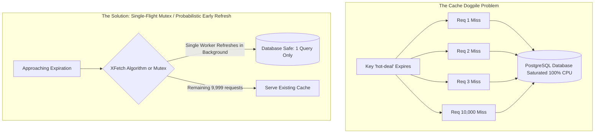

# Multi-Tier Distributed Caching & Read-Heavy Architectures

In systems with extreme read-to-write ratios (e.g., Twitter 100:1, Wikipedia 1,000:1), persistent databases cannot survive without a layered caching architecture.

---

## 1. The Multi-Tier Caching Topology (L1 / L2 / L3)

```mermaid
graph TD
    Client[Client Browser / Mobile] --> L3[L3: CDN Edge Cache (Cloudflare / Front Door)]
    L3 -->|Cache Miss| L1[L1: In-Process Memory Cache (MemoryCache)]
    L1 -->|Cache Miss| L2[L2: Distributed Redis Cluster]
    L2 -->|Cache Miss| DB[(Persistent Primary Database)]
```

### Layer Breakdown
- **L3 (CDN Edge)**: Caches static media, public REST responses, and cacheable HTML snippets closest to the user ($< 20\text{ms}$).
- **L1 (Local Process Memory)**: High-speed in-process cache (e.g., `IMemoryCache` in .NET). Near-zero latency ($< 1\text{ }\mu\text{s}$), zero network serialization overhead.
- **L2 (Distributed Cache)**: Shared multi-node cluster (Redis / Memcached). Ensures consistent state across auto-scaling compute pods ($1-3\text{ms}$).

---

## 2. Cache Invalidation Patterns

| Pattern | Read Flow | Write Flow | Pros & Cons |
|---|---|---|---|
| **Cache-Aside (Lazy Loading)** | App reads cache; on miss, reads DB and populates cache. | App writes directly to DB, then invalidates cache key. | **Pros**: Only requested data is cached. **Cons**: Cache miss penalty on cold reads. |
| **Write-Through** | App reads cache. | App writes to cache; cache synchronously writes to DB. | **Pros**: Cache is never stale. **Cons**: High write latency (waits for both writes). |
| **Write-Behind (Write-Back)** | App reads cache. | App writes to cache; cache asynchronously writes to DB in batches. | **Pros**: Incredible write speed. **Cons**: Risk of data loss if cache node crashes before flush. |

---

## 3. Eliminating Cache Stampede (Dogpiling)

When a hot key expires under high load, thousands of concurrent requests miss the cache simultaneously and assault the database.



### Production Solution: Single-Flight Invalidation Pattern in C#
```csharp
using System.Collections.Concurrent;

namespace Enterprise.SystemDesign.Caching;

public class SingleFlightCache<T>
{
    private readonly ConcurrentDictionary<string, Task<T>> _inFlightFetches = new();

    public async Task<T> GetOrFetchAsync(string key, Func<Task<T>> factory)
    {
        // 1. If another thread is already fetching this key, await their existing Task!
        var fetchTask = _inFlightFetches.GetOrAdd(key, _ => factory());

        try
        {
            return await fetchTask;
        }
        finally
        {
            // Remove from in-flight tracker once completed
            _inFlightFetches.TryRemove(key, out _);
        }
    }
}
```
