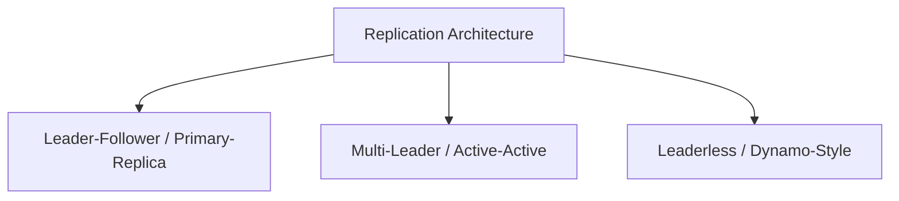
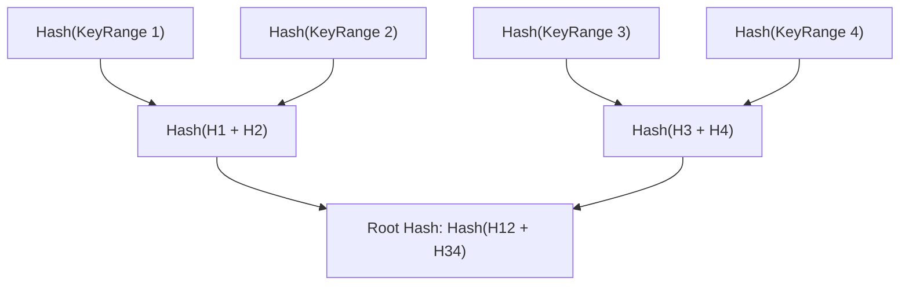

# Storage Internals: Consensus, Quorums & Replication Topologies

To design large-scale distributed databases and state stores, a Principal Architect must understand how underlying storage engines replicate bytes, maintain leader consensus, and recover from network partitions.

---

## 1. Replication Topologies Compared



### 1. Leader-Follower (Single-Master)
- **Write Path**: 100% of writes route to the designated leader.
- **Read Path**: Reads scale horizontally across read replicas.
- **Replication**: Can be synchronous (slow, zero data loss) or asynchronous (fast, potential data loss upon failover).
- **Failure Mode**: When leader crashes, consensus algorithm (Raft/Paxos) elects a new leader.

### 2. Multi-Leader (Multi-Master)
- **Write Path**: Writes accepted in multiple datacenters simultaneously.
- **Advantage**: Low write latency across global regions; survivability if a region fails.
- **Fatal Challenge**: **Conflict Resolution**. Concurrent conflicting writes to the same row require conflict resolution strategies:
  - *Last-Write-Wins (LWW)*: Drops data based on unsynchronized NTP clocks.
  - *Conflict-Free Replicated Data Types (CRDTs)*: Mathematically proven convergence.

### 3. Leaderless (Dynamo-Style: Cassandra, ScyllaDB, Amazon Dynamo)
- **Write Path**: Client writes to any $N$ storage nodes.
- **Read Path**: Client reads from any $R$ storage nodes.

---

## 2. Quorum Arithmetic: $R + W > N$

In leaderless distributed datastores, consistency is governed by the Strict Quorum Inequality:

$$R + W > N$$

- $N$: Number of replicas in the cluster (e.g., $N = 5$).
- $W$: Minimum write acknowledgments required before success (e.g., $W = 3$).
- $R$: Minimum read acknowledgments required before returning data (e.g., $R = 3$).

```text
Cluster Replicas (N = 5): [ Node 1, Node 2, Node 3, Node 4, Node 5 ]

Write Phase (W = 3):
[ Node 1 (v2), Node 2 (v2), Node 3 (v2), Node 4 (v1), Node 5 (v1) ]

Read Phase (R = 3):
Client queries Node 3, Node 4, Node 5.
Responses: [ v2, v1, v1 ]
Result: Client picks v2 (highest version timestamp)!
```

Because $R + W = 3 + 3 = 6 > 5$, the Pigeonhole Principle guarantees that the read set and write set must overlap by at least one node, ensuring the client always observes the most recent version!

---

## 3. Anti-Entropy & Merkle Trees

When a partitioned node rejoins the cluster, how does it synchronize missing data without streaming terabytes of unchanged database records over the network?

Datastores use **Merkle Trees** (cryptographic hash trees):



1. Nodes compare their root hashes. If equal, data is 100% identical; zero data transfer needed.
2. If root hashes differ, nodes traverse down to child hashes.
3. Only the specific sub-ranges whose hashes differ are synchronized over the network, minimizing replication bandwidth by 99.9%.
