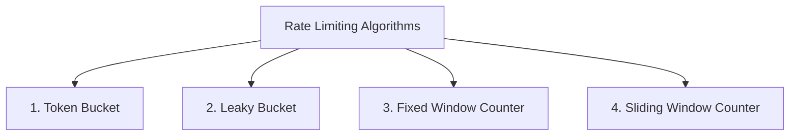
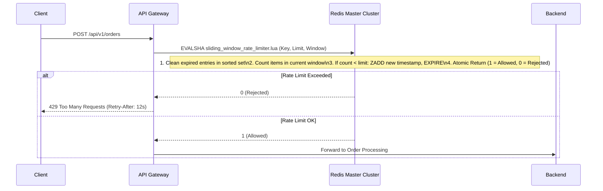

# Rate Limiting & Traffic Shaping at Internet Scale

When external traffic surges unpredictably (e.g., flash sales, scraping bots, volumetric DDoS), rate limiting is the primary defense line preventing cascading resource exhaustion.

---

## 1. Rate Limiting Algorithms Compared



### Comparison Matrix

| Algorithm | Burst Handling | Memory Overhead | Accuracy | Common Use Cases |
|---|---|---|---|---|
| **Token Bucket** | **Excellent** (Allows burst up to bucket capacity) | Low ($O(1)$ per client) | High | General API Gateway rate limiting (AWS, Stripe) |
| **Leaky Bucket** | None (Smooths bursts to constant rate) | Low ($O(1)$ per client) | High | Egress traffic shaping, message queue dispatch |
| **Fixed Window** | Poor (Double-burst at window boundary) | Extremely Low | Low (Boundary bias) | Simple low-precision rate caps |
| **Sliding Window Log** | Good | **Extremely High** ($O(N)$ events stored) | 100% Exact | Low-volume, high-value financial endpoints |
| **Sliding Window Counter** | Good (Weighted rolling interpolation) | Very Low ($O(1)$ per client) | $\approx 99\%$ Accurate | High-scale distributed rate limiting (Cloudflare) |

---

## 2. Distributed Sliding-Window Counter via Atomic Redis Lua

To rate-limit across hundreds of stateless API Gateway pods, state must be synchronized in a central store (Redis) atomically to avoid race conditions.



### Production Redis Lua Script (`rate_limiter.lua`)
```lua
-- KEYS[1]: Rate limit key (e.g., "rate:tenant-123")
-- ARGV[1]: Current UNIX timestamp in milliseconds
-- ARGV[2]: Sliding window size in milliseconds (e.g., 60000 for 1 min)
-- ARGV[3]: Maximum allowed requests within window

local key = KEYS[1]
local now = tonumber(ARGV[1])
local window = tonumber(ARGV[2])
local limit = tonumber(ARGV[3])
local clearBefore = now - window

-- 1. Remove timestamps older than the sliding window
redis.call('ZREMRANGEBYSCORE', key, 0, clearBefore)

-- 2. Count requests currently within the sliding window
local currentRequests = redis.call('ZCARD', key)

if currentRequests < limit then
    -- 3. Allowed: Add current timestamp to sorted set
    redis.call('ZADD', key, now, now)
    redis.call('PEXPIRE', key, window)
    return 1
else
    -- 4. Rejected: Rate limit breached
    return 0
end
```

---

## 3. Concurrency Limits & Little's Law

Rate limiting based solely on requests per second (RPS) fails when backend services experience latency degradation. If backend response times jump from 50ms to 5,000ms, an RPS rate limit will still allow 100x more concurrent in-flight requests into the system, exhausting thread pools.

A Principal Architect applies **Little's Law**:

$$L = \lambda \times W$$

- $L$: Average number of concurrent requests in the system.
- $\lambda$: Inbound request arrival rate (RPS).
- $W$: Average response time (latency).

### The Invariant
If your backend pool can safely handle $L = 500$ concurrent requests, and latency $W$ increases to $2\text{ seconds}$, you must dynamically shed traffic arrival rate $\lambda$ down to:

$$\lambda = \frac{L}{W} = \frac{500}{2\text{s}} = 250\text{ req/sec}$$

Concurrency-based limiters (e.g., Netflix Concurrency Limits) measure p99 latency in real time and dynamically throttle ingress before thread pool starvation occurs.
