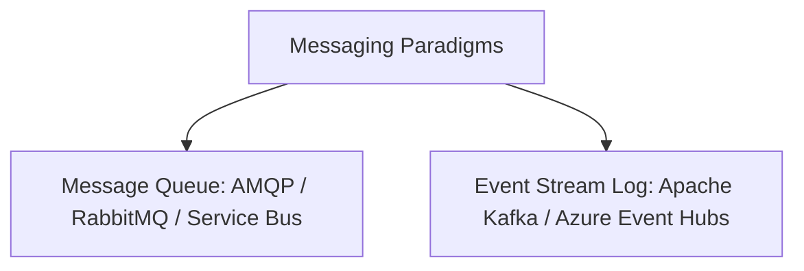
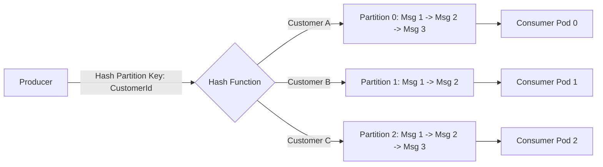
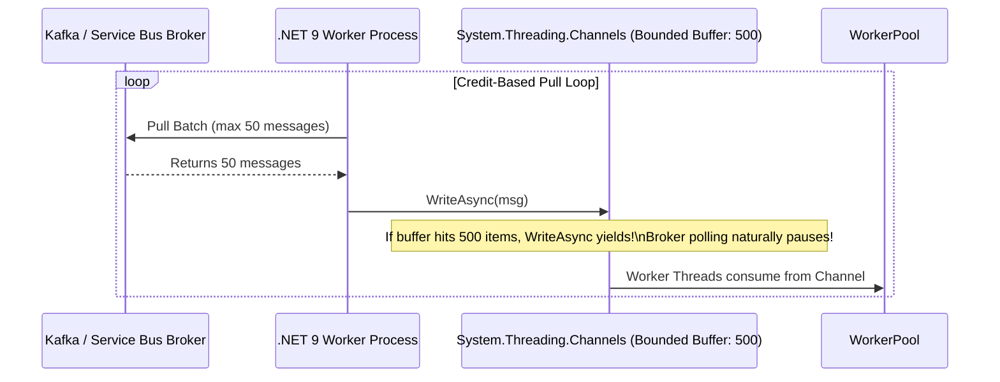

# Asynchronous Event-Driven Architectures & Reactive Backpressure

Synchronous HTTP calls between microservices create deep runtime coupling, amplify latency, and turn isolated component faults into system-wide cascading outages.

Asynchronous event-driven architecture decouples producers from consumers using distributed message logs and brokers.

---

## 1. Message Brokers vs. Distributed Event Streaming Logs



### Architectural Comparison Matrix

| Feature | Message Queues (RabbitMQ / Azure Service Bus) | Distributed Event Logs (Kafka / Event Hubs) |
|---|---|---|
| **Storage Model** | Transient (Message deleted once acknowledged) | Persistent (Append-only immutable log; retained by TTL) |
| **Consumption Model** | Broker pushes to competing consumers | Consumers pull by tracking partition offsets |
| **Ordering** | FIFO per queue/session | Strictly ordered **per partition key** |
| **Replayability** | No (Once consumed, it is gone) | **Yes** (Rewind offset to reprocess history) |
| **Routing** | Complex exchange routing (Topic, Direct, Fanout) | Simple topic and partition hashing |
| **Scale Target** | 10k - 50k messages/sec | **1,000,000+ events/sec** |

---

## 2. Partitioning Strategy & The Ordering Dilemma

Distributed streaming platforms (Kafka, Event Hubs) achieve linear scale through **partitioning**. However, ordering is only guaranteed within a single partition.



### Rules for Partition Keys
1. **Choose High Cardinality**: The partition key must have high cardinality (e.g., `CustomerId`, `OrderId`). Low cardinality keys (e.g., `CountryCode`) cause **hot partitions**, where one partition saturates while others sit idle.
2. **Never Reorder Transactions**: For financial transactions, use `AccountId` as the partition key. All deposits, withdrawals, and balance updates for that specific account are serialized onto the same partition, guaranteeing FIFO processing without distributed locks.

---

## 3. Reactive Backpressure & Pull-Based Flow Control

Push-based consumers are vulnerable to memory exhaustion when upstream message velocity exceeds consumer processing speed.



### Implementation in C# (.NET 9)
```csharp
using System.Threading.Channels;

namespace Enterprise.SystemDesign.Messaging;

public class BoundedMessageConsumer<TMessage>
{
    private readonly Channel<TMessage> _channel;

    public BoundedMessageConsumer(int boundedCapacity = 500)
    {
        // Bounded channel provides physical backpressure
        _channel = Channel.CreateBounded<TMessage>(new BoundedChannelOptions(boundedCapacity)
        {
            FullMode = BoundedChannelFullMode.Wait,
            SingleWriter = true,
            SingleReader = false
        });
    }

    public async Task ProduceToChannelAsync(IAsyncEnumerable<TMessage> incomingStream, CancellationToken ct)
    {
        await foreach (var message in incomingStream.WithCancellation(ct))
        {
            // If internal consumer threads are slow, WriteAsync pauses here
            // preventing the process from consuming unbounded memory!
            await _channel.Writer.WriteAsync(message, ct);
        }
    }

    public async Task StartWorkerPoolAsync(Func<TMessage, Task> processor, int workerCount, CancellationToken ct)
    {
        var tasks = Enumerable.Range(0, workerCount).Select(async _ =>
        {
            while (await _channel.Reader.WaitToReadAsync(ct))
            {
                while (_channel.Reader.TryRead(out var msg))
                {
                    await processor(msg);
                }
            }
        });

        await Task.WhenAll(tasks);
    }
}
```
