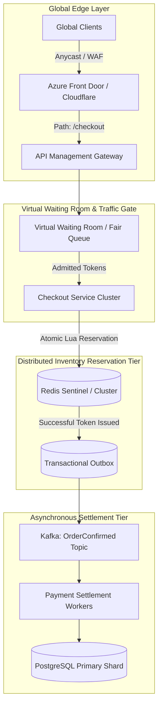
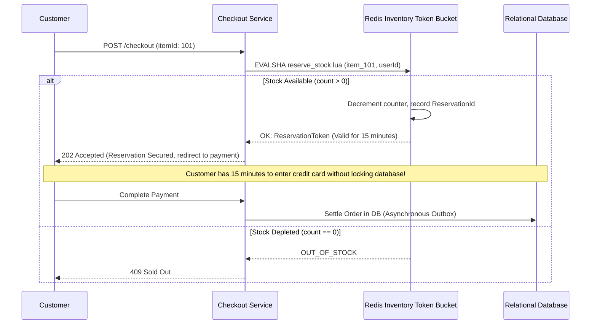

# Case Study 1: Global High-Availability E-Commerce Flash-Sale Platform

Designing a global e-commerce engine capable of surviving a 100,000 RPS flash sale with zero inventory oversell and 99.999% availability.

---

## 1. System Requirements & Constraints

- **Scale**: 100,000 requests per second at peak.
- **Inventory Constraint**: Exactly 50,000 units of stock. **Zero overselling** allowed (hard business invariant).
- **Latency**: p99 checkout latency $< 200\text{ms}$.
- **Global Availability**: Multi-region active-active deployment across Americas, Europe, and Asia.

---

## 2. End-to-End Architecture Blueprint



---

## 3. Deep Dive: The Two-Phase Inventory Reservation Engine

To prevent database row lock contention during 100k RPS surges, inventory is decoupled into **In-Memory Reservation Tokens** and **Asynchronous Settlement**.



### Redis Reservation Lua Script
```lua
-- KEYS[1]: stock key (e.g. "stock:phone-2026")
-- KEYS[2]: reservations key (e.g. "reservations:phone-2026")
-- ARGV[1]: userId
-- ARGV[2]: expiration timestamp (now + 15 min)

local stock = tonumber(redis.call('GET', KEYS[1]) or "0")

if stock > 0 then
    redis.call('DECR', KEYS[1])
    redis.call('HSET', KEYS[2], ARGV[1], ARGV[2])
    return 1 -- Success
else
    return 0 -- Sold out
end
```

### Why This Design Is Unbeatable:
1. **Zero Database Locks**: The relational database never experiences concurrent row locks on `stock`. It processes orders smoothly downstream via Kafka.
2. **Deterministic Oversell Protection**: Redis single-threaded execution guarantees that `stock` will never drop below 0.
3. **Automatic Abandonment Expiration**: A background worker scans `reservations` for expired tokens ($> 15\text{ minutes}$) and returns unclaimed stock back to `stock` via `INCR`.
