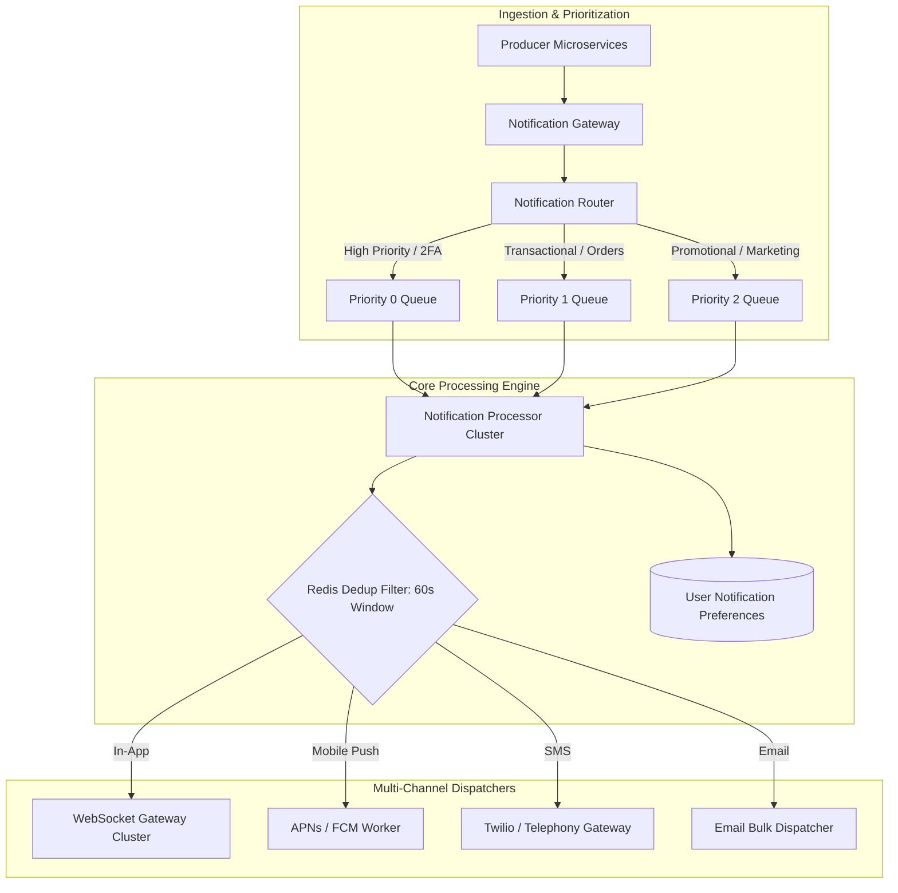
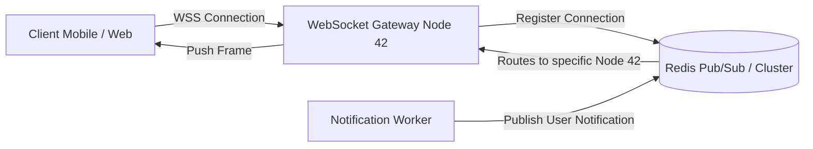

# Case Study 2: Real-Time Multi-Tenant Notification Platform

Architecting a global notification platform capable of delivering push notifications, WebSockets, SMS, and emails to 50,000,000 Daily Active Users with priority queuing and strict deduplication.

---

## 1. System Requirements & Scale

- **Scale**: 50M DAU; 100,000,000 notifications sent per day; peak bursts of 200,000 messages/sec during major breaking news or flash events.
- **Channels**: In-App WebSockets, Mobile Push (APNs / FCM), Email (SendGrid / SES), SMS (Twilio).
- **Latency**: High-priority alerts (e.g., 2FA codes) delivered in $< 3\text{ seconds}$; promotional marketing delivered in $< 30\text{ minutes}$.
- **Deduplication**: Zero duplicate notifications within a 60-second window.

---

## 2. High-Level Architecture Blueprint



---

## 3. Deep Dive: Global WebSocket Connection Management

Maintaining 10,000,000 persistent concurrent WebSocket connections requires specialized horizontal scaling.



### Connection Topology Mechanics
1. **Stateless Gateway Nodes**: Each WebSocket node holds 50,000 to 100,000 open TCP sockets (using epoll on Linux / Socket completion ports on Windows).
2. **Session Registry in Redis**: When a user connects to Node 42, an entry is recorded: `user:usr-101 -> node_42`.
3. **Targeted Dispatch**: When a notification arrives for `usr-101`, the worker checks the registry and publishes the message to the Redis channel `channel:node_42`. Only Node 42 receives the message and pushes it down the socket, eliminating broadcast storms.

---

## 4. Sliding-Window Deduplication Algorithm

To prevent downstream provider errors from firing duplicate SMS messages to users, the engine enforces idempotent deduplication:

```csharp
namespace Enterprise.SystemDesign.Notifications;

public class NotificationDeduplicator
{
    private readonly StackExchange.Redis.IConnectionMultiplexer _redis;

    public NotificationDeduplicator(StackExchange.Redis.IConnectionMultiplexer redis) => _redis = redis;

    public async Task<bool> ShouldSendAsync(string userId, string notificationContentHash, TimeSpan window)
    {
        var db = _redis.GetDatabase();
        var dedupKey = $"dedup:{userId}:{notificationContentHash}";

        // SET NX (Set if Not Exists) with expiry
        // Returns true if key was set (first time seen); false if already exists
        return await db.StringSetAsync(dedupKey, "1", window, StackExchange.Redis.When.NotExists);
    }
}
```
