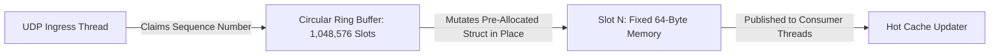

# Case Study 3: 500,000 RPS Financial Market Telemetry Ingestion

Architecting an ultra-low-latency financial market data ingestion pipeline processing 500,000 market tick events per second with sub-millisecond in-memory distribution and persistent columnar storage.

---

## 1. System Requirements & Constraints

- **Throughput**: 500,000 market ticks per second sustained; 1,500,000 ticks/sec peak during market open/close.
- **Latency**: Internal processing latency $< 5\text{ milliseconds}$ (p99).
- **Data Integrity**: Zero tick loss. Append-only immutable historical audit log.
- **Query Profile**:
  - *Hot Path*: Real-time algorithmic trading engines querying current market prices ($< 1\text{ms}$).
  - *Cold Path*: Quantitative research teams running analytical SQL queries across petabytes of historical tick data.

---

## 2. High-Level Architecture Blueprint (CQRS / Lambda Pipeline)

```mermaid
graph TB
    subgraph MarketFeeds ["Stock Exchange Feeds (NASDAQ / NYSE / LSE)"]
        Ex1[Exchange Feed FIX/ITCH] --> UDP[Kernel-Bypass UDP Ingress]
    end

    subgraph HotIngestTier ["Hot Path: Sub-Millisecond Processing"]
        UDP --> RingBuffer[LMAX Disruptor Ring Buffer (.NET 9)]
        RingBuffer --> InMemCache[(Shared Memory / HugePages Cache)]
        InMemCache --> AlgoTrading[Algorithmic Execution Engine]
    end

    subgraph ColdPersistenceTier ["Cold Path: Columnar Historical Analytics"]
        RingBuffer --> Kafka[Kafka Tick Topic - 64 Partitions]
        Kafka --> ParquetWriter[Columnar Parquet Batch Writer]
        ParquetWriter --> ADLS[(Object Storage Data Lake - Parquet)]
        ADLS --> QueryEngine[Trino / DuckDB / Synapse Analytics]
    end
```

---

## 3. Deep Dive: Zero-Allocation Ingestion via Ring Buffers (Disruptor Pattern)

At 500,000 ticks/sec, allocating standard C# objects (`new MarketTick()`) produces 500k allocations/second, overwhelming the .NET Garbage Collector and inducing severe stop-the-world Gen 2 pauses.

The solution is the **LMAX Disruptor Ring Buffer Pattern** using pre-allocated unmanaged memory or pooled structs:



### Memory-Optimized Struct Definition (.NET 9 C# 13)
```csharp
using System.Runtime.InteropServices;

namespace Enterprise.SystemDesign.Financial;

[StructLayout(LayoutKind.Sequential, Pack = 8)]
public struct MarketTickStruct
{
    public long TimestampUtcTicks; // 8 bytes
    public ulong SymbolId;          // 8 bytes
    public double BidPrice;         // 8 bytes
    public double AskPrice;         // 8 bytes
    public long BidSize;            // 8 bytes
    public long AskSize;            // 8 bytes
    public uint SequenceNumber;     // 4 bytes
    private fixed byte Padding[12]; // Pad struct to exact 64 bytes (CPU cache line size!)
}
```

### Why the 64-Byte Struct Layout is Mandatory:
- **Zero GC Allocations**: Structs are pre-allocated in an array of size $2^{20}$ (1,048,576 slots) at server startup. Zero runtime heap memory is requested.
- **Cache Line Alignment**: Sized to exactly 64 bytes. This prevents **false sharing**, allowing adjacent CPU cores to read and write neighboring slots without cache line bouncing.

---

## 4. Columnar Storage for Cold Analytics (Apache Parquet)

Row-based databases (PostgreSQL, MySQL) fail for historical analytics because querying the average price of Apple (`AAPL`) over 6 months requires reading every unrelated column (BidSize, AskSize, Timestamp) from disk.

The cold path batches ticks into **Apache Parquet**:
- **Columnar Projection**: Only the requested column (`BidPrice`) is read from disk, reducing disk I/O by 85%.
- **Snappy / Zstandard Compression**: Columnar data has extreme repetition, achieving 10:1 compression ratios.
