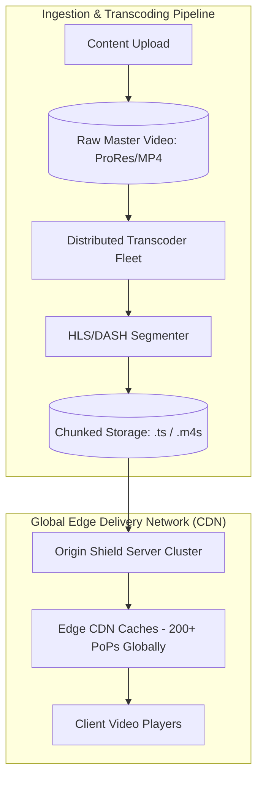
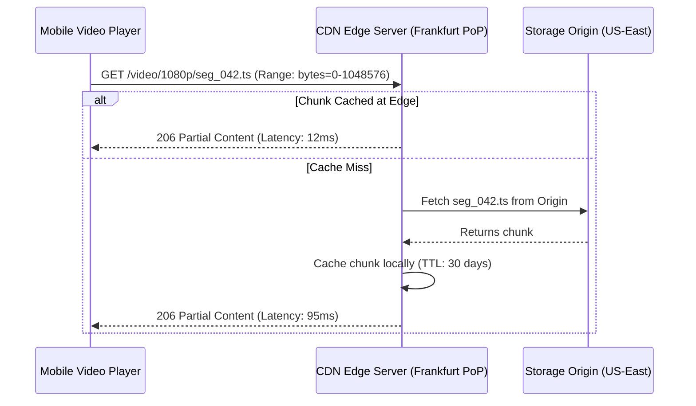

# Case Study 4: Distributed Video Streaming & Content Delivery (HLS/DASH)

Designing a planetary-scale video streaming architecture capable of serving millions of concurrent video streams with adaptive bitrate streaming (HLS/DASH) and edge caching.

---

## 1. System Requirements & Scale

- **Scale**: 10,000,000 concurrent streaming users.
- **Catalog**: 100,000 movies and series (average 4K movie: 15 GB).
- **Latency**: Sub-second playback start time ($< 800\text{ms}$ time-to-first-frame); zero buffering during playback.
- **Device Diversity**: Adaptive playback across mobile (3G/4G/5G), browsers, and 4K Smart TVs.

---

## 2. High-Level Architecture Blueprint



---

## 3. Deep Dive: Adaptive Bitrate Streaming (HLS & MPEG-DASH)

Monolithic video files (e.g., streaming a single 15 GB `.mp4` file) are impossible over mobile networks because network fluctuations cause playback stalls.

Adaptive Bitrate Streaming slices videos into **independent 2-to-6 second chunks**:

```text
master.m3u8 (Master Manifest)
├── 1080p.m3u8 (Bandwidth: 5000 kbps)
│   ├── segment_001.ts (2 seconds)
│   ├── segment_002.ts (2 seconds)
│   └── ...
├── 720p.m3u8 (Bandwidth: 2500 kbps)
│   ├── segment_001.ts
│   └── ...
└── 360p.m3u8 (Bandwidth: 800 kbps)
    ├── segment_001.ts
    └── ...
```

### Client-Driven Dynamic Adaptation
1. The video player continuously measures inbound download bandwidth.
2. If network throughput drops (e.g., user enters a subway tunnel), the player requests the next 2-second chunk from the `360p` playlist instead of `1080p`.
3. Playback continues uninterrupted with lower resolution, eliminating buffering freezes.

---

## 4. Edge CDN Caching & Byte-Range Optimization



- **HTTP 206 Partial Content**: Enables instant scrubbing. When a user skips forward to minute 45, the player requests only the byte range corresponding to chunk 450, avoiding downloading intermediate data.
- **Cache Hit Ratio ($> 98\%$)**: The top 20% of popular videos are cached directly on SSDs at edge Points of Presence (PoPs) worldwide, ensuring 98% of streaming traffic never hits the origin storage cluster.
