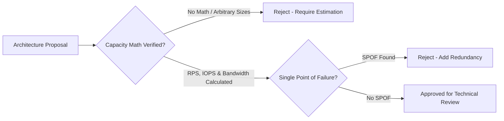

# Principal System Design Review Checklist & Risk Matrix

Before presenting an architecture to the Architecture Review Board (ARB) or launching a critical distributed platform, a Principal Architect audits the design against this comprehensive production checklist.

---

## 1. Scale & Capacity Boundary Gate



- [ ] **Back-of-the-Envelope Validation**: QPS (average vs peak), storage growth (TB/year), ingress/egress bandwidth (Gbps), and memory footprint have been mathematically estimated.
- [ ] **Data Partitioning & Sharding Key**:
  - Shard keys possess high cardinality ($|K| > 1,000,000$).
  - No monolithic hot keys (e.g., celebrity users or generic global date keys).
  - Consistent hashing utilizes virtual nodes (100+ v-nodes per physical machine).
- [ ] **Zero Unbounded Queries**: Every read API enforces keyset pagination and hard page size limits (`LIMIT 50`). Unbounded `SELECT *` without limits is prohibited.

---

## 2. Distributed Consistency & Resilience Gate

- [ ] **Explicit Consistency Model**: Every datastore interaction is categorized explicitly: Strong Consistency (ACID) vs Eventual Consistency (BASE).
- [ ] **No Two-Phase Commit (2PC) over Network**: Distributed workflows use **Orchestrated Sagas** or the **Transactional Outbox Pattern** instead of blocking 2PC locks.
- [ ] **Idempotent Consumer Protection**:
  - Every message consumer enforces unique idempotency keys via relational Inbox deduplication tables or Redis `SET NX`.
- [ ] **Cache Stampede Defense**: High-traffic cached entities implement single-flight mutexes or probabilistic early refresh (XFetch).
- [ ] **Graceful Degradation Paths**: If secondary dependencies (e.g., recommendation engine, analytics) fail, the core user journey (e.g., checkout) continues functioning.

---

## 3. Traffic Shaping & Admission Control Gate

```mermaid
flowchart TD
    A[Inbound Traffic Surge] --> B{Edge Rate Limiter}
    B -->|Exceeds Token Bucket| C[429 Too Many Requests]
    B -->|Within Limit| D{Concurrency Limiter}
    D -->|Backend Saturated (p99 > 2s)| E[Shed Load / Virtual Waiting Room]
    D -->|Capacity Available| F[Process Transaction]
```

- [ ] **Multi-Tier Rate Limiting**: Token bucket or sliding-window rate limiters are configured at API Gateways (per IP, per authenticated user, per API key).
- [ ] **Concurrency Limits (Little's Law)**: Ingress proxies dynamically shed load when downstream latency exceeds safety thresholds.
- [ ] **Circuit Breakers Configured**: Remote dependencies are wrapped with Polly v8 circuit breakers with appropriate break durations and failure rate thresholds.

---

## 4. Security, Privacy & Blast Radius Gate

- [ ] **Zero Trust Network Isolation**: Backend databases and queues reside in private subnets with zero public IP exposure.
- [ ] **No Secrets in Configuration**: Managed identities and Key Vaults are used exclusively.
- [ ] **PII Scrubbing in Logs and Traces**: Credit cards, passwords, and tokens are redacted at the application layer before reaching telemetry sinks.
- [ ] **Blast Radius Isolation**: Workloads are partitioned into isolated failure domains (cellular architecture / spoke VNets) so that a failure in one region or tenant cannot take down the entire system.
