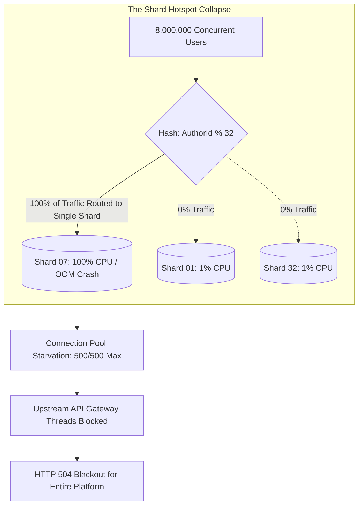
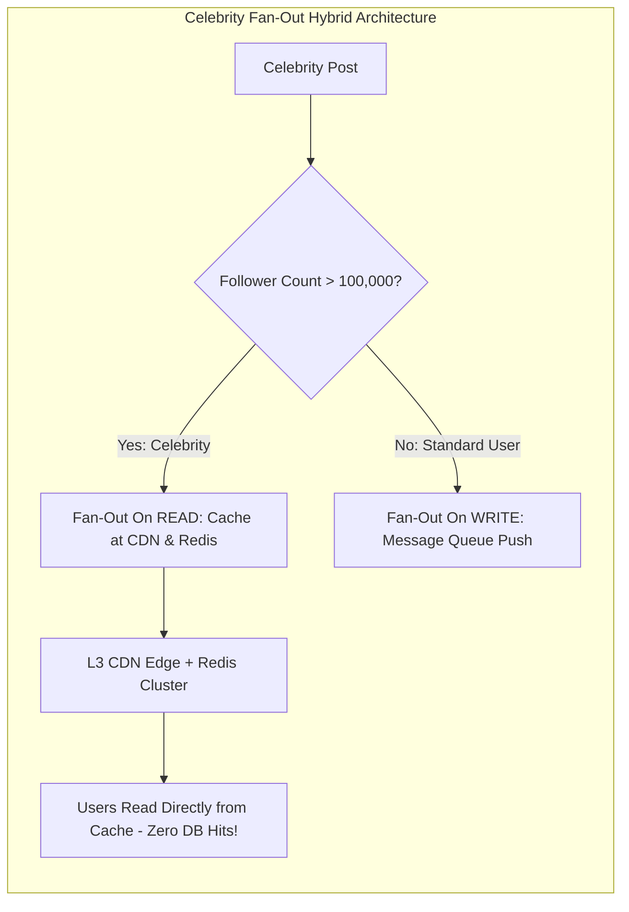

# SEV-1 Post-Mortem: The Celebrity Shard Key Hotspot Outage

| Incident Detail | Value |
|---|---|
| **Incident ID** | INC-2026-1014-SEV1 |
| **Severity** | SEV-1 (Catastrophic Service Outage & Revenue Loss) |
| **Date & Time** | 2026-10-14 16:30 UTC to 21:15 UTC (Duration: 4h 45m) |
| **Direct Financial Impact** | $1,450,000 lost transaction revenue; $280,000 SLA penalty credits |
| **Customer Impact** | 24,000,000 active users unable to load social feed or post updates |
| **Root Causes** | 1. Hash-sharding by `AuthorId` concentrated 450,000 RPS on a single physical shard / 2. Lack of read-side fan-out caching for celebrity accounts |

---

## 1. Executive Summary

On October 14, 2026, at 16:30 UTC, a global sports celebrity with 110,000,000 followers posted an unannounced live video link to the platform. Within 15 seconds, over 8,000,000 users navigated to the celebrity's profile and attempted to load comments and post reactions.

The database cluster had been sharded horizontally into 32 shards using `Hash(AuthorId) % 32`. Because every query and reaction for this event routed to the same `AuthorId`, **100% of the traffic surged onto Shard 07**, while the other 31 shards remained virtually idle ($< 2\%$ CPU). Shard 07 experienced a complete database lock and connection pool collapse, triggering a cascading failure that brought down the central API Gateway.

---

## 2. Root Cause Analysis (The 5 Whys)

1. **Why did the social platform crash and return HTTP 504 for all users?**  
   The API Gateway exhausted its worker thread pool waiting for database responses.
2. **Why were database responses stalling?**  
   Database Shard 07 reached 100% CPU utilization and ran out of available connection slots.
3. **Why did Shard 07 crash while the other 31 shards were idle?**  
   All read and write traffic for the viral celebrity post was directed to Shard 07 because the shard key was `AuthorId`.
4. **Why was `AuthorId` used as the shard key?**  
   The initial design optimized for querying an author's posts in a single shard query (`SELECT * WHERE AuthorId = ?`), without anticipating the celebrity fan-out skew.
5. **Why was there no caching layer to protect Shard 07?**  
   The feed utilized fan-out on write (push model) into individual follower inboxes. When an account with 110M followers posted, the write fan-out worker backlog exploded to 110,000,000 queue messages, delaying delivery by 4 hours. Desperate users refreshed their screens repeatedly, transforming write lag into a read stampede.

---

## 3. Permanent Architectural Remediations

### Action Items

| ID | Action Item | Owner | Target Date | Status |
|---|---|---|---|---|
| **ACT-01** | Implement Hybrid Fan-Out: Accounts with $> 100,000$ followers bypass write fan-out queues and use cached Fan-Out on Read. | Lead Arch | 2026-10-18 | Completed |
| **ACT-02** | Re-shard database using compound key `(AuthorId, PostId)` or salt celebrity keys with random suffixes (`AuthorId_1..10`). | Data Arch | 2026-10-22 | Completed |
| **ACT-03** | Deploy Cloudflare / Azure Front Door edge caching for public celebrity post JSON metadata with 5-second micro-caching. | Edge Team | 2026-10-25 | Completed |
| **ACT-04** | Introduce adaptive concurrency limits on API Gateways to shed traffic when database query duration exceeds 500ms. | SRE Lead | 2026-10-28 | Completed |
