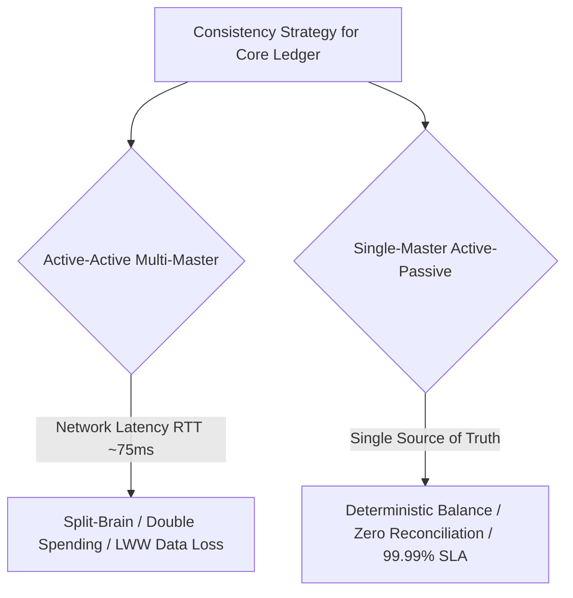

# Principal System Design Defense Scenarios

As a Principal Architect, you must defend technical trade-offs, consistency boundaries, and structural investments in front of executive leadership (CTO, CFO, CISO), product managers, and engineering teams.

---

## Scenario 1: Defending Single-Master Active-Passive over Multi-Master Active-Active

### The Challenge
> *"Our engineering directors want Active-Active Multi-Master replication across US and Europe so that both regions can write directly to local databases. Why are you insisting on Single-Master Active-Passive for our core ledger?"*

### The Principal Defense

- **The Mathematical Reality (PACELC Theorem)**:  
  *"In a core financial ledger or inventory balance system, data consistency is a non-negotiable business invariant. If we allow writes in both US and Europe simultaneously, cross-Atlantic network latency (75ms RTT) physically guarantees that two users can spend the same balance or reserve the same physical stock before replication packets cross the ocean. Resolving conflicts via 'Last-Write-Wins' means silently dropping valid customer transactions based on unsynchronized clocks."*

- **The Trade-Off & Solution**:  
  *"We will route 100% of write traffic to the primary master region over optimized backbone connections, completing transactions in 85ms with guaranteed ACID correctness. We will deploy read replicas in Europe for lightning-fast ($< 5\text{ms}$) localized reads. If the primary region suffers a total catastrophe, we execute an automated failover with a Recovery Point Objective (RPO) of zero."*

---

## Scenario 2: Defending Fan-Out on Read vs Fan-Out on Write (The Celebrity Problem)

### The Challenge
> *"Our senior engineers argue that Fan-Out on Write (pushing a tweet to all follower inboxes upon creation) is faster for users. Why are you rejecting pure Fan-Out on Write?"*

### The Principal Defense
- **The Fan-Out Multiplication Penalty**:  
  *"Fan-Out on Write works beautifully when users have 200 followers: 1 tweet generates 200 message queue operations. But when a celebrity with 80 million followers posts, that single tweet generates 80,000,000 write operations into 80 million Redis lists. Our message broker queues back up for hours, starving normal users' messages and exhausting Redis memory."*
- **The Hybrid Solution**:  
  *"We adopt a **Hybrid Fan-Out Architecture**. For 99.9% of normal users ($< 25,000$ followers), we use Fan-Out on Write for instant timeline delivery. For celebrity accounts ($> 25,000$ followers), we do not push their posts to follower queues. Instead, when a follower opens their home timeline, the system pulls the celebrity's latest posts from a high-speed cache and merges them on the fly. This bounds write amplification while maintaining sub-100ms feed loading."*

---

## Scenario 3: Defending Orchestrated Sagas over Two-Phase Commit (2PC)

### The Challenge
> *"Why can't we just use distributed transactions (2PC/XA) across our microservices to make sure payments and orders either commit together or roll back cleanly?"*

### The Principal Defense
- **The Availability & Lock Trap**:  
  *"Two-Phase Commit requires all database participants to hold row locks between the Prepare and Commit phases. In a microservices architecture communicating over cloud networks, a network hiccup or coordinator crash causes those locks to be held indefinitely. A single slow database degrades the availability of every other service in the chain. Furthermore, external third-party payment gateways like Stripe or PayPal do not support 2PC."*
- **The Resilient Alternative**:  
  *"We use **Orchestrated Sagas with the Transactional Outbox Pattern**. Each service commits local database transactions independently. The orchestrator tracks state transitions in a durable state machine. If payment fails, the orchestrator triggers automated compensating transactions (e.g., releasing reserved inventory). We trade temporary inconsistency for infinite horizontal scalability and zero deadlock risk."*

---

## Additional Defense Scenarios Matrix

| Scenario | Opposing Argument | Principal Defense Stance |
|---|---|---|
| **4. Consistent Hashing** | "Modulo hashing (`hash % N`) is simpler than a consistent hash ring." | Modulo hashing requires moving $\frac{N-1}{N}$ of all keys when adding a node, triggering a massive database cache flush. Consistent hashing moves only $\frac{1}{N}$ keys. |
| **5. Database Sharding Key** | "Let's shard the orders table by `CreatedAtDate`." | Sharding by date directs 100% of current write traffic to the latest month's shard, creating an extreme hot spot. Shard by `Hash(CustomerId)` for uniform distribution. |
| **6. Microservices vs Monolith** | "Let's break our application into 60 microservices immediately." | Microservices introduce distributed complexity, network latency, and eventual consistency. Start with a modular monolith; extract microservices only along bounded business boundaries. |
| **7. WebSockets at Scale** | "Let's just broadcast every event to all connected WebSocket servers." | Broadcast storms saturate internal networks. Use a central Redis session registry to route messages exclusively to the specific server holding the target user's socket. |
| **8. Asynchronous Processing** | "Why not process payments synchronously in the HTTP request?" | Synchronous payment calls leave browser connections open for 3-5 seconds. If traffic surges, thread pools starve. Return `202 Accepted` and process asynchronously via queues. |
| **9. Read-After-Write Consistency** | "Read replicas are cheap; route all user reads to replicas." | Replication lag causes users to refresh and see missing data immediately after saving. Route read-after-write requests for the creating user to the primary for 5 seconds. |
| **10. Caching Database Queries** | "Cache every SQL query result in Redis for 10 minutes." | Caching raw query strings creates cache invalidation nightmares. Cache normalized domain entities (e.g., `user:101`) and invalidate by entity ID. |
| **11. Distributed Locking** | "Use Redis locks (Redlock) for all concurrent operations." | Distributed locks introduce latency, clock drift vulnerabilities, and single points of failure. Use optimistic concurrency (`version = version + 1`) or atomic Lua operations. |
| **12. Kafka vs RabbitMQ** | "RabbitMQ is easier; why deploy Kafka?" | RabbitMQ deletes messages after consumption. Kafka provides an immutable, replayable append-only log, enabling event sourcing and multiple independent consumer groups. |
| **13. API Rate Limiting** | "Rate limit only by client IP address." | Multiple enterprise corporate buyers share single proxy IP addresses. IP-only rate limiting blocks thousands of legitimate users. Rate limit by authenticated `TenantId` or API key. |
| **14. Eventual Consistency in UI** | "Users will be confused if they don't see their updates instantly." | Use optimistic UI updates on the frontend (render the post immediately) while background network sync completes asynchronously. |
| **15. Telemetry Egress Costs** | "Ship all raw traces and logs to our central cloud region." | Cross-region egress charges cost hundreds of thousands of dollars. Deploy local collector agents with tail sampling to drop 95% of healthy traces at the edge. |

---

## 💰 The FinOps & Unit-Economics Defense Axis (10-System-Design)

### Question (The CFO / CTO Cost Challenge):
> *"This architecture is technically textbook, but we are killing it because the enterprise managed tier / over-provisioned footprint costs $15,000/month. Defend the 80%-good alternative at 20% of the cost, and state the exact quantitative threshold where upgrading becomes justified."*

**Principal Defense**:
1. **Unit-Economics First**: At early-to-mid scale (`< 1,500 RPS`), paying `$15,000/month` for dedicated multi-cluster licensing or 10x idle headroom violates unit economics (`Cost per 1M requests`).
2. **The 80%-Good Architecture at 20% Cost (`~$2,200/month`)**:
   - Replace network-chatty sidecars/clusters with in-process L1/L2 caching (`HybridCache`), bounded `System.Threading.Channels`, and modular monolith / shared-cluster partitioning with strict tenant/bulkhead quotas.
   - Apply tail-based sampling (`100%` errors, `1%` happy path) and topology-aware AZ routing to eliminate cross-AZ egress waste.
3. **Quantitative Upgrade Trigger (Invalidation Criteria)**:
   - We revisit and fund the `$15,000/month` tier only when sustained $p95$ load exceeds `8,000 RPS` for 14 consecutive days OR when contractual SLA downtime penalties exceed `$250,000/year`.

