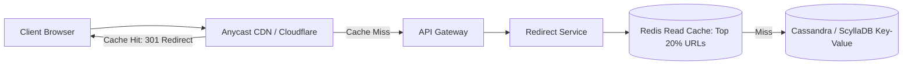
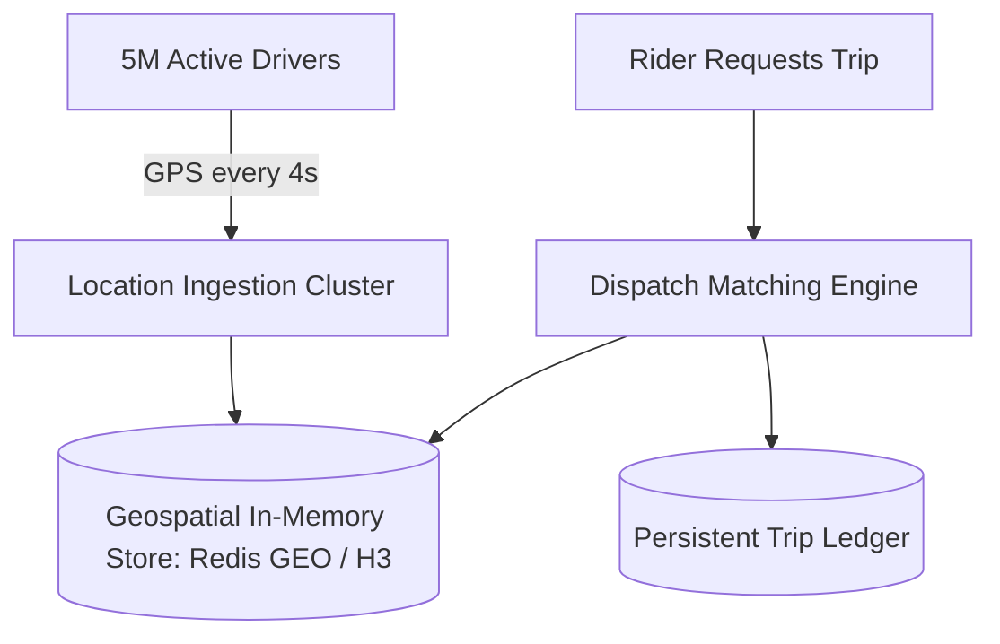

# Principal System Design Interview Scenarios

These 5 Staff and Principal-level interview case studies evaluate end-to-end architectural leadership, capacity modeling, distributed trade-offs, and failure mode mitigation.

---

## Scenario 1: Distributed URL Shortener at Planetary Scale (Bitly / TinyURL)

### The Prompt
> *"Design a URL shortening service handling 100,000,000 new URLs per month and 10,000,000,000 redirects per month with sub-10ms redirect latency and 99.999% availability."*

### Key Architectural Solutions
1. **Capacity Math**:
   - Write QPS: $\frac{100\text{M}}{86,400 \times 30} \approx 38.5\text{ writes/sec}$.
   - Read QPS: $\frac{10\text{B}}{86,400 \times 30} \approx 3,850\text{ reads/sec}$ (Peak: 8,000 RPS). Read-to-write ratio: 100:1.
   - Storage (5 years): $100\text{M} \times 60 \text{ months} \times 500\text{ Bytes} = 3\text{ TB}$ (fits in a small distributed cluster).
2. **Short Key Generation (Base62)**:
   - 7 characters of Base62 (`[a-zA-Z0-9]`) yields $62^7 \approx 3.5\text{ trillion}$ unique URLs.
   - Distributed Unique ID Generator (Snowflake / ZooKeeper range allocator) produces a 64-bit integer, which is Base62 encoded.
3. **Latency Optimization**:
   - HTTP 301 (Permanent) vs HTTP 302 (Found): 301 allows browser-level local caching (zero server hits), but 302 allows tracking click analytics. We use 302 with a 5-minute `Cache-Control` header.

---

## Scenario 2: Real-Time Ride-Sharing Dispatch Engine (Uber / Lyft)

### The Prompt
> *"Design a real-time ride-sharing dispatch system tracking 5,000,000 active drivers reporting GPS coordinates every 4 seconds, matching riders to nearby drivers in under 2 seconds."*

### Key Architectural Solutions
1. **Geospatial Indexing (Uber H3 / Google S2)**:
   - Traditional B-Tree indexes fail under 1.25M updates/sec ($5\text{M} / 4\text{s}$).
   - Divide the planet into hexagonal cells using **Uber H3** (resolution 8: $\approx 460\text{m}$ edge length).
   - Driver location update simply sets a Redis sorted set: `ZADD geo:hex_842a... <timestamp> <driver_id>`.
2. **Matching Engine Algorithm**:
   - When a rider requests a trip, compute the rider's H3 hexagon index.
   - Query the central hexagon and 6 adjacent neighboring hexagons (ring 1).
   - Filter available drivers by status (`status:idle`), calculate ETA via routing engine, and dispatch trip offer.

---

## Scenario 3: Real-Time Collaborative Document Editing (Google Docs / Figma)

### The Prompt
> *"Design a real-time collaborative document editing platform supporting 50 concurrent editors on a single document with zero edit loss, sub-50ms peer synchronization, and offline editing capability."*

### Key Architectural Solutions
- **Why Operational Transformation (OT) Fails for P2P/Offline**: OT requires a centralized server to serialize and transform operation matrices. Under network partitions or offline edits, transformation matrices diverge.
- **The CRDT Solution (Conflict-Free Replicated Data Types)**:
  - Utilize **RGA (Replicated Growable Array)** or **Yjs / Loro CRDT** structures.
  - Every character has a globally unique ID `(LamportTimestamp, ClientId)` and fractional position index.
  - Concurrent insertions converge deterministically through mathematical join-semilattice properties without central lock arbitration.

---

## Scenario 4: Planetary Distributed Rate Limiting System

### The Prompt
> *"Design a global rate-limiting platform deployed across 50 data centers enforcing a global quota of 10,000 requests/minute per enterprise customer without adding more than 2ms latency to API calls."*

### Key Architectural Solutions
- **Local Token Batches**: A central coordinator allocates token "allowances" in batches (e.g., 500 tokens at a time) to local datacenter edge proxies.
- Local proxies decrement their local token balance in memory ($< 0.1\text{ms}$).
- When a local allowance drops below 20%, the edge proxy asynchronously requests the next batch from the central cluster.
- Eliminates synchronous cross-region network calls on the API request path.

---

## Scenario 5: Financial Ledger & Settlement Engine (Stripe / Adyen)

### The Prompt
> *"Architect a double-entry financial ledger handling $100B in annualized transactions. Strict ACID compliance, zero data loss, immutable audit trail, and multi-currency exchange."*

### Key Architectural Solutions
- **Double-Entry Accounting Invariant**: Every financial transaction consists of at least one debit and one credit. Sum of debits must equal sum of credits: $\sum \text{Debits} - \sum \text{Credits} = 0$.
- **Immutable Append-Only Ledger**: Balances are never updated in place (`UPDATE accounts SET balance = ...` is strictly banned). Balances are computed by summing immutable ledger entries.
- **Storage Tier**: PostgreSQL with synchronous replication, RCSI isolation, and cryptographic SHA-256 hash chaining on ledger rows to prove non-tampering to external financial auditors.
