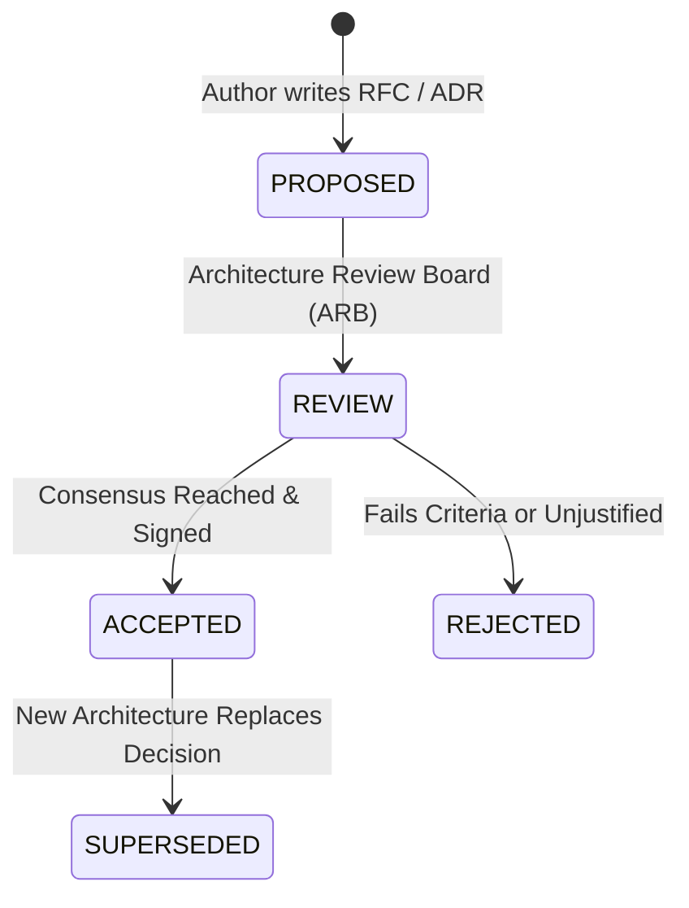

# Architecture Decision Records (ADR) Mastery

Code shows *how* a system works; an **Architecture Decision Record (ADR)** documents *why* it was built that way. A Principal Architect uses ADRs to preserve institutional memory, communicate trade-offs, and prevent cyclical re-litigation of past decisions.

---

## 1. The Standard Michael Nygard ADR Template

```markdown
# ADR-042: Adoption of Kafka Event Sourcing for Order Fulfillment

## Status
ACCEPTED (Supercedes ADR-018: Synchronous REST Order Processing)

## Context & Problem Statement
Our current monolithic order processing engine relies on synchronous HTTP REST calls between the Order, Payment, and Warehouse services. During the 2026 Black Friday flash sale, downstream database lock contention in the Warehouse service caused thread starvation in the upstream Order service, resulting in a 4-hour outage and $12M in lost transactions.

We need an architecture that decouples order ingestion from settlement, provides guaranteed FIFO ordering per customer account, and allows replaying transactions in the event of downstream consumer crashes.

## Decision Drivers
- Must support 100,000 requests/sec at peak.
- Must guarantee zero data loss (RPO = 0).
- Must eliminate synchronous HTTP lock dependencies.
- Must preserve event history for regulatory financial audits.

## Considered Options
1. **Option 1**: Apache Kafka / Azure Event Hubs (Distributed Immutable Append-Only Log)
2. **Option 2**: RabbitMQ / Azure Service Bus (Traditional Transient Message Queuing)
3. **Option 3**: Two-Phase Commit (2PC / XA Transactions) across microservices

## Decision Outcome
Chosen Option: **Option 1 (Apache Kafka)**.

### Positive Consequences
- Ingestion is completely decoupled; Order API returns HTTP 202 Accepted within 15ms.
- Events are retained for 30 days, enabling full historical replay during consumer bugs.
- Linear scalability achieved by partitioning topics on `CustomerId`.

### Negative Consequences & Trade-Offs
- Eventual consistency introduces complexity; UI must handle pending states.
- Operational overhead of managing Kafka broker clusters and consumer group offsets.

## Rejected Alternatives
- **Option 2 (RabbitMQ)** was rejected because it deletes messages upon consumer acknowledgment, making historical event replaying impossible.
- **Option 3 (2PC)** was rejected because distributed locking introduces severe availability degradation and high latency under scale.
```

---

## 2. The Principal ADR Governance Lifecycle



### The 4 Rules of Enduring ADRs
1. **Store in Git Alongside Code**: Store ADRs in `/docs/adr/` within the source repository. When code changes, the ADR is committed in the same pull request.
2. **Document the Trade-Offs Honestly**: An ADR with no negative consequences is a marketing document, not an engineering decision. Every architecture choice trades something away (complexity, consistency, cost).
3. **Immutable History**: Never edit an accepted ADR to reflect a new decision. Author a new ADR (e.g., `ADR-055`) that explicitly marks the old one as `SUPERSEDED`.
4. **Enforce Without Bureaucracy**: An ADR should take less than 1 hour to draft. Keep it under 2 pages.
