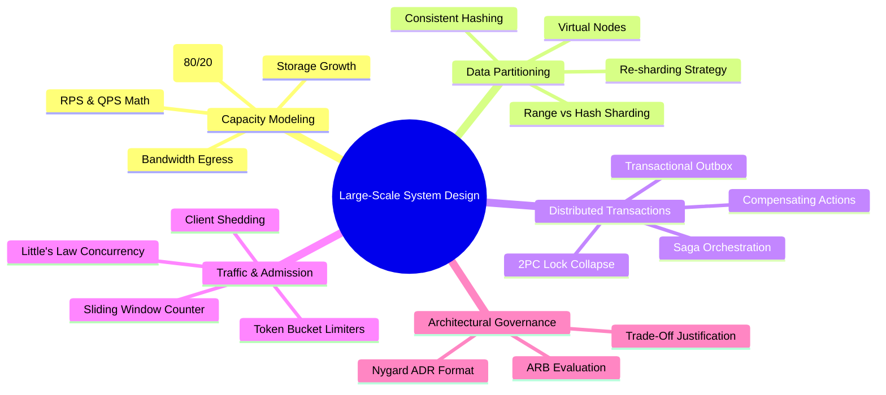
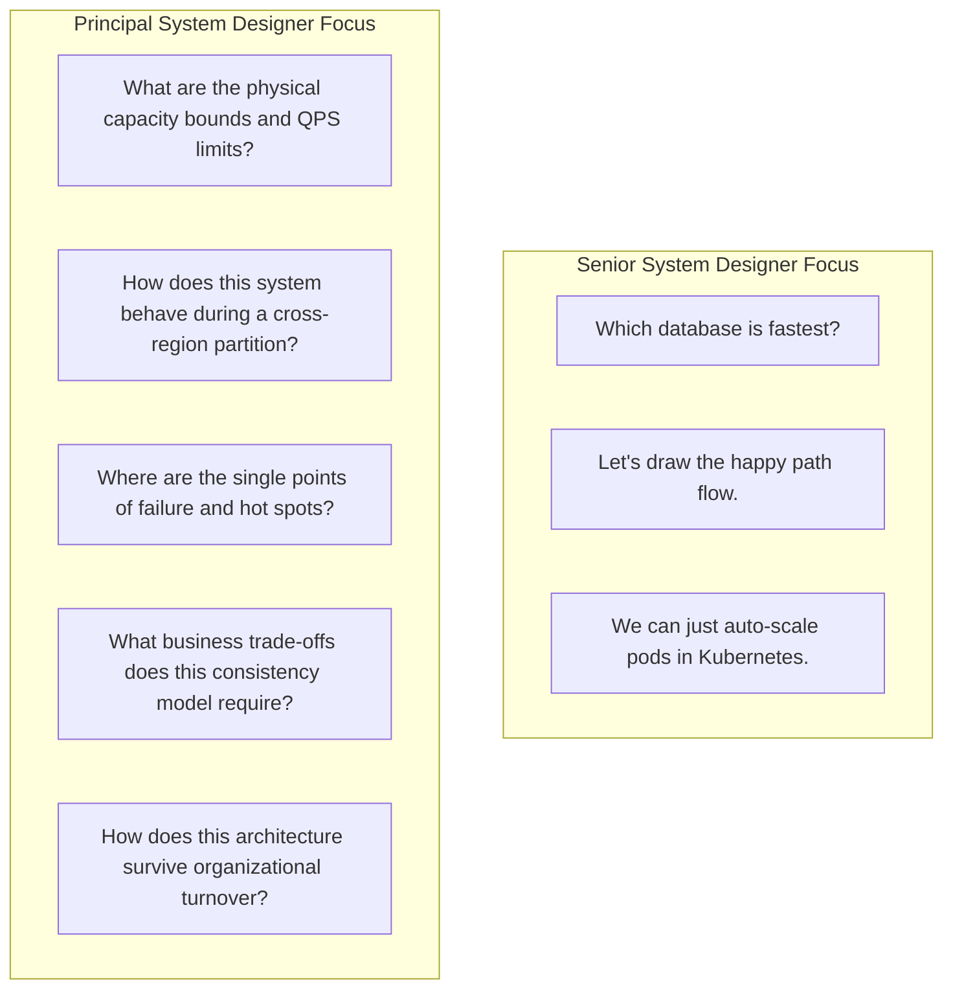

# Sprint 10 Summary: Large-Scale System Design

Sprint 10 marks the synthesis of the entire Principal Engineer Journey curriculum. It transforms theoretical knowledge into the pragmatic mastery of planetary-scale distributed architecture.

---

## Core System Design Pillars Covered

---

## The Principal System Design Decision Matrix

| Challenge | Choose This | Avoid This | Rationale |
|---|---|---|---|
| **Data Partitioning** | Consistent Hashing with V-Nodes | Modulo Hashing (`hash % N`) | Modulo hashing flushes the entire cluster on node addition; consistent hashing migrates only $\frac{1}{N}$ keys. |
| **Cross-Service Transactions** | Orchestrated Saga + Outbox | Two-Phase Commit (2PC / XA) | 2PC holds exclusive database row locks over cloud networks, destroying availability and causing deadlocks. |
| **Hot Key Invalidation** | Single-Flight Mutex / XFetch | Raw Cache-Aside without locking | Prevents thousands of concurrent requests from stampeding the database upon cache key expiration. |
| **High-Volume Ingestion** | Append-Only Event Log (Kafka) | Relational Table Direct Inserts | Append-only logs sequentialize disk writes, handling 1,000,000 events/sec with zero locking contention. |
| **Traffic Defense** | Concurrency-Aware Rate Limiting | Static RPS Limits | Static limits fail when downstream latency spikes; concurrency limits dynamically shed load to protect thread pools. |
| **Decision Documentation** | Git-Tracked Markdown ADRs | Verbal agreements / Wiki sprawl | Preserves architectural rationale across team turnover and eliminates cyclical re-litigation. |

---

## What Distinguishes a Senior from a Principal System Designer

A Senior Engineer designs systems that work.  
A **Principal Engineer** designs systems that cannot be broken by traffic surges, withstand catastrophic hardware failures, and empower the entire engineering organization through clear, enduring architectural decisions.
