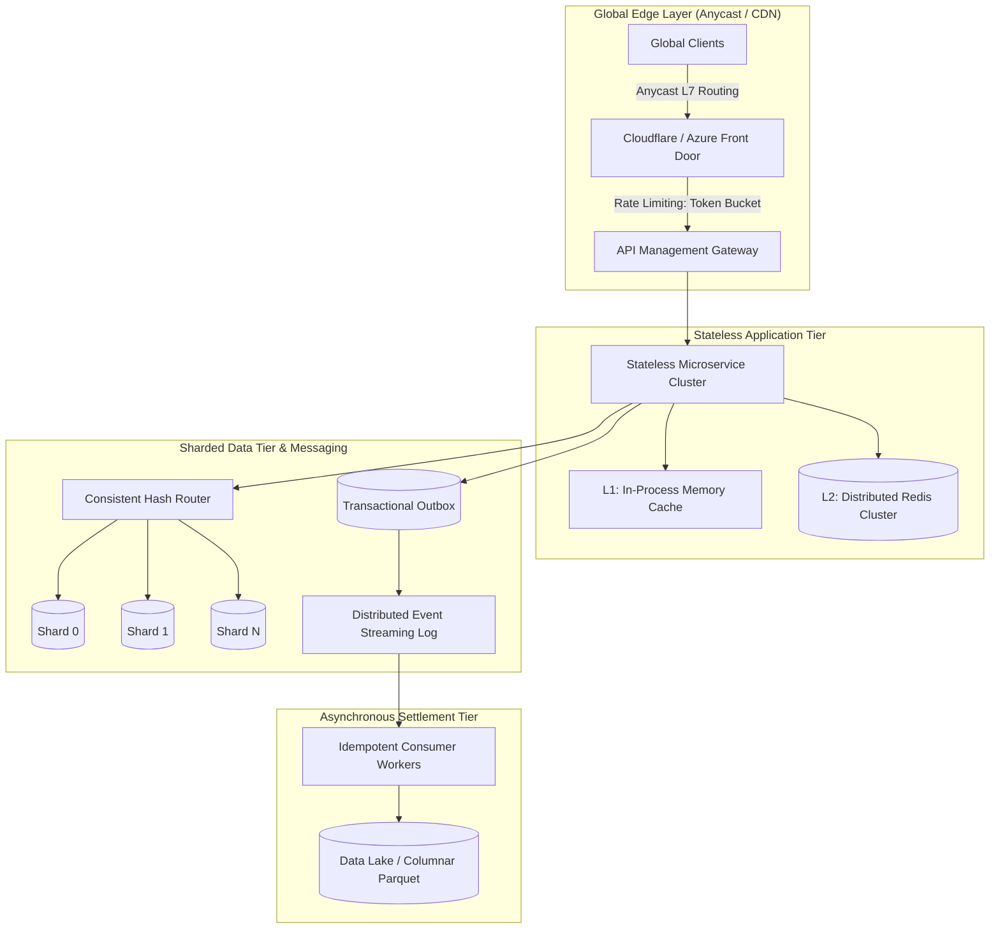

# Sprint 10: Large-Scale System Design

Welcome to **Sprint 10** of the Principal Engineer Journey. This module is the master-level culmination of planetary-scale distributed systems architecture, capacity modeling, distributed transactions, and architectural governance.

---

## Chapter Directory

| # | Chapter Document | Core Themes & Technologies |
|---|---|---|
| **01** | [`01-Story.md`](01-Story.md) | SEV-1: The Flash-Sale Collapse & The $12M Split-Brain Inventory Oversell |
| **02** | [`02-Learning-Objectives.md`](02-Learning-Objectives.md) | Bloom's Taxonomy & Principal Competencies across Large-Scale Architecture |
| **03** | [`03-Capacity-Estimation-And-SLA-Math.md`](03-Capacity-Estimation-And-SLA-Math.md) | Back-of-the-Envelope Math: RPS/QPS, Network Bandwidth, Storage & Memory Sizing |
| **04** | [`04-System-Design-Framework-And-Methodology.md`](04-System-Design-Framework-And-Methodology.md) | The Principal 5-Stage System Design Framework & Trade-Off Methodology |
| **05** | [`05-Database-Partitioning-And-Sharding-Architecture.md`](05-Database-Partitioning-And-Sharding-Architecture.md) | Range vs Hash Sharding, Consistent Hashing with V-Nodes, Zero-Downtime Re-sharding |
| **05A**| [`05A-Inside-Distributed-Transactions-2PC-vs-Saga.md`](05A-Inside-Distributed-Transactions-2PC-vs-Saga.md) | Two-Phase Commit (2PC) Blocking Lock Pitfalls vs Orchestrated Saga Patterns |
| **06** | [`06-Distributed-Caching-And-Read-Heavy-Architectures.md`](06-Distributed-Caching-And-Read-Heavy-Architectures.md) | L1/L2/L3 Multi-Tier Caching, Cache Invalidation, Dogpiling & Single-Flight Mutexes |
| **06A**| [`06A-Inside-Consensus-And-Replication-Internals.md`](06A-Inside-Consensus-And-Replication-Internals.md) | Storage Internals: Quorums ($R+W>N$), Dynamo-Style Replication, Merkle Trees |
| **07** | [`07-Rate-Limiting-And-Traffic-Shaping-At-Scale.md`](07-Rate-Limiting-And-Traffic-Shaping-At-Scale.md) | Token Bucket, Leaky Bucket, Sliding-Window Redis Lua Limiters, Little's Law |
| **08** | [`08-Asynchronous-Event-Driven-Architectures-And-Backpressure.md`](08-Asynchronous-Event-Driven-Architectures-And-Backpressure.md) | Kafka vs RabbitMQ, Partitioning Strategies, Consumer Groups & Bounded Channels |
| **09** | [`09-Design-Pattern-Global-ECommerce-Platform.md`](09-Design-Pattern-Global-ECommerce-Platform.md) | Case Study 1: Global E-Commerce Flash Sale (100k RPS, Reservation Tokens) |
| **10** | [`10-Design-Pattern-Real-Time-Notification-Engine.md`](10-Design-Pattern-Real-Time-Notification-Engine.md) | Case Study 2: Real-Time Multi-Tenant Notification Engine (50M DAU, WebSockets) |
| **11** | [`11-Design-Pattern-Massive-Financial-Telemetry-Ingestion.md`](11-Design-Pattern-Massive-Financial-Telemetry-Ingestion.md) | Case Study 3: 500,000 RPS Financial Market Telemetry Ingestion (LMAX Disruptor) |
| **12** | [`12-Design-Pattern-Distributed-Blob-And-Video-Streaming.md`](12-Design-Pattern-Distributed-Blob-And-Video-Streaming.md) | Case Study 4: Distributed Video Streaming (HLS/DASH Chunking, Edge CDN) |
| **13** | [`13-Principal-System-Design-Checklist.md`](13-Principal-System-Design-Checklist.md) | Principal System Design Review Checklist & Production Risk Matrix |
| **14** | [`14-Hands-On-System-Design-Labs.md`](14-Hands-On-System-Design-Labs.md) | 5 Production Labs: Consistent Hash Ring, Redis Lua Limiter, Outbox Saga, Cache |
| **15** | [`15-Production-Incident-Post-Mortem.md`](15-Production-Incident-Post-Mortem.md) | SEV-1 Post-Mortem: The Celebrity Shard Key Hotspot Outage & Cascade Collapse |
| **16** | [`16-Principal-System-Design-Defense-Questions.md`](16-Principal-System-Design-Defense-Questions.md) | 15 Deep Defense Scenarios for CTO, CFO, CISO & Architecture Review Boards |
| **17** | [`17-Principal-System-Design-Interview-Scenarios.md`](17-Principal-System-Design-Interview-Scenarios.md) | 5 Staff/Principal System Design Interview Scenarios (Bitly, Uber H3, Google Docs) |
| **18** | [`18-Architecture-Decision-Records-ADR-Mastery.md`](18-Architecture-Decision-Records-ADR-Mastery.md) | Authoring Enduring ADRs: Context, Decision, Consequences, Status, Governance |
| **19** | [`19-Summary.md`](19-Summary.md) | Sprint 10 Executive Summary & Architectural Synthesis: Senior vs Principal |
| **20** | [`20-Resources.md`](20-Resources.md) | Curated Landmark Research Papers, System Design Classics, Formal Specs |
| **README** | [`README.md`](README.md) | Sprint 10 Architecture Map, Topology Diagram & Complete Chapter Navigation |

*(Note: Links format reflects standardized filenames; exact paths listed in table)*

---

## Key Architectural Principles

1. **Calculate Before Designing**: Never choose a database or queue without back-of-the-envelope capacity estimation (QPS, bandwidth, storage, memory).
2. **Partition by Bounded Keys**: Shard data using high-cardinality keys with consistent hashing; prevent single-key celebrity hot spots using hybrid fan-out.
3. **Decouple Ingestion from Settlement**: Protect persistent databases from raw traffic surges using in-memory reservation tokens and asynchronous append-only event streams.
4. **Embrace Eventual Consistency**: Eliminate blocking two-phase commits across microservices; standardize on Orchestrated Sagas and the Transactional Outbox pattern.
5. **Document Rationale in Code**: Preserve engineering context by committing Architecture Decision Records (ADRs) directly in Git alongside the source code.
