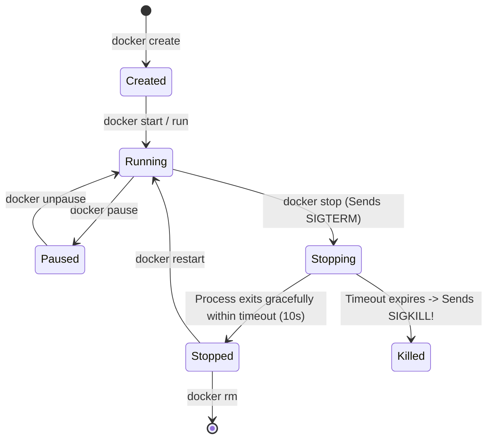

# Container Lifecycle Management, CLI Mastery & Cloud Registries

> "A container is not a virtual machine.
>
> A container is a standard Linux process isolated by cgroups and namespaces. Understanding process signals, resource limits, and registry operations is mandatory for operational stability."

---

## 1. Container Lifecycle & Process Signals



### Invariant: Graceful Shutdown via `SIGTERM`
When Kubernetes or Docker terminates a container:
1. Docker sends **`SIGTERM` (Signal 15)** to PID 1 inside the container.
2. The application has **10 seconds** (configurable grace period) to:
   - Stop accepting new incoming HTTP connections.
   - Finish processing in-flight requests.
   - Flush logging and telemetry buffers.
   - Commit active database transactions.
3. If PID 1 does not exit within 10 seconds, the kernel sends **`SIGKILL` (Signal 9)**, violently terminating the process and corrupting in-flight state.

> ⚠️ **Common Trap: Shell Form vs Exec Form in ENTRYPOINT**:
> - Shell form: `ENTRYPOINT dotnet Nova.dll` runs `/bin/sh -c "dotnet Nova.dll"`. The shell becomes PID 1 and **swallows SIGTERM**, preventing your .NET app from ever shutting down gracefully!
> - Exec form (Mandatory): `ENTRYPOINT ["dotnet", "Nova.dll"]` ensures your app is PID 1 and receives OS signals directly.

---

## 2. Docker CLI Power Commands for Troubleshooting

```bash
# 1. Run container with explicit CPU and memory boundaries
docker run -d --name nova-api     -p 8080:8080     --memory="512m"     --cpus="1.5"     --restart=on-failure:5     nova-commerce:v1.0.0

# 2. Inspect real-time container metrics (CPU, RAM, Network I/O)
docker stats nova-api --no-stream

# 3. Stream container logs with timestamps and line limit
docker logs -f --tail=100 -t nova-api

# 4. Execute an interactive diagnostics shell inside a running container
docker exec -it nova-api /bin/sh

# 5. Inspect container metadata, environment variables, and exit code
docker inspect nova-api --format='{{.State.ExitCode}} - {{.State.OOMKilled}}'
```

---

## 3. Cloud Container Registries (ACR, ECR, Docker Hub)

### Image Tagging Hierarchy:
Never deploy ambiguous tags:

```text
┌─────────────────────────────────┬─────────────────────────────────────────────────────────────┐
│ Tagging Pattern                 │ Evaluation & Production Rule                                │
├─────────────────────────────────┼─────────────────────────────────────────────────────────────┤
│ myregistry.azurecr.io/api:latest│ ❌ BANNED in Production: Non-deterministic and un-reproducible│
│ myregistry.azurecr.io/api:1.4.2 │ ⚠️ Better: Semantic version, but does not identify source   │
│ myregistry.azurecr.io/api:1.4.2-b9e4a12 │ ✅ GOLD STANDARD: SemVer + Git Commit SHA (Immutable)│
└─────────────────────────────────┴─────────────────────────────────────────────────────────────┘
```

### Registry Operations via Azure CLI & Docker:
```bash
# Authenticate to private registry
az acr login --name novacommerceacr

# Tag image with registry URI, semver, and git sha
docker tag nova-commerce:local novacommerceacr.azurecr.io/production/nova-api:v1.4.2-b9e4a12

# Push to private container registry
docker push novacommerceacr.azurecr.io/production/nova-api:v1.4.2-b9e4a12
```
