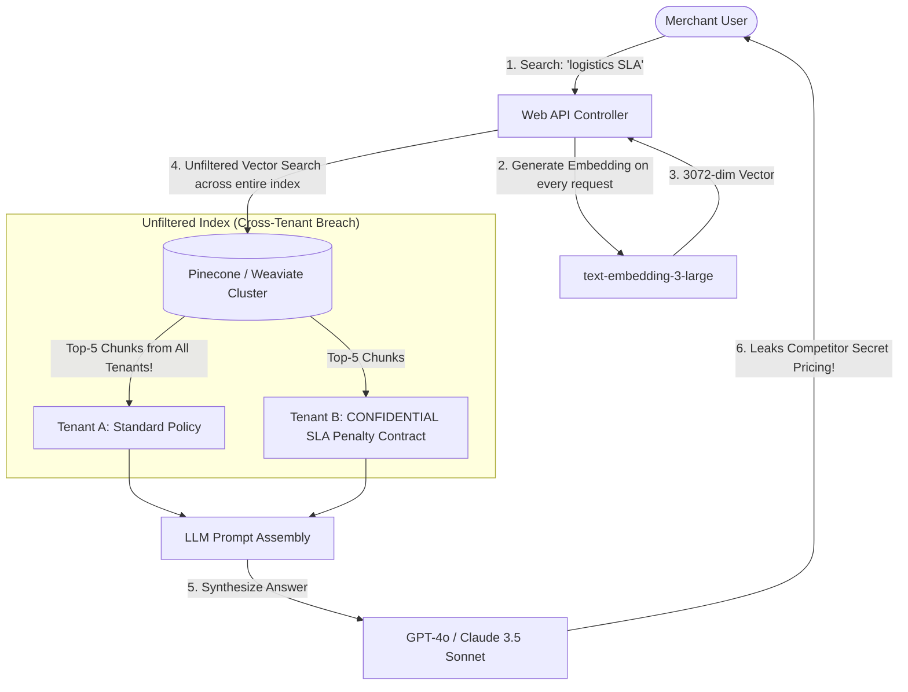

# The Incident: The Hallucination Outage & The $140,000 Unbounded Vector Bill

On November 18, 2026, at 09:14 UTC, Nova Commerce launched "NovaCopilot"—an AI-powered enterprise assistant designed to answer complex merchant inquiries, analyze warehouse inventory contracts, and troubleshoot real-time delivery escalations.

Within 48 hours of public availability, two catastrophic events forced an immediate emergency shutdown of the system:
1. **The $140,000 Vector Database Spike**: An unindexed, brute-force kNN semantic search query was executed on every merchant keystroke. Without embedding caching or dimensionality pruning, the serverless vector database auto-scaled to 1,200 read units, burning $140,000 in API compute in 36 hours.
2. **The Confidential Contract Hallucination & Security Leak**: A Tier-1 vendor asked NovaCopilot: *"What are the standard penalty terms for delayed logistics?"* Because the RAG pipeline lacked **document-level access filtering and metadata multi-tenancy**, the retriever pulled embedded confidential PDF contracts from a competing multi-national supplier and injected them directly into the context window. The LLM synthesized and cited the competitor's secret volume discount schedules verbatim.

---

## 1. Anatomy of the Failure

The initial implementation had been assembled using simple tutorial-style code:

### The Three Root Causes Identified in the Post-Mortem:
1. **Zero Access Control in the Embedding Space**: The engineering team treated the vector database as a flat global key-value store. Chunks were indexed without tenant IDs, user permissions, or document access control lists (ACLs). Any user could retrieve any document if the semantic cosine similarity was high enough.
2. **Naïve Fixed-Length Chunking**: Documents were split arbitrarily every 500 characters, severing legal clauses from their governing headers. The model hallucinated that an indemnification clause applied to all merchants because the chunk containing the limitation of liability had been truncated.
3. **Absence of Grounding and Re-ranking**: The system trusted raw vector similarity scores. Irrelevant chunks with false semantic overlap dominated the context window, overwhelming the model's reasoning capacity and triggering hallucinated contract terms.

---

## 2. The Principal Engineer Intervention

The Principal AI Architect established three immutable engineering invariants:

1. **Permission-Aware Retrieval Before Prompt Assembly**:
   Vector search queries MUST include deterministic metadata filters (`tenant_id == current_tenant` AND `allowed_roles IN user_roles`) before cosine distance calculation occurs. No vector leaves the database if the calling user lacks explicit read permission.
2. **Hybrid Search with Cross-Encoder Re-Ranking**:
   Combine sparse keyword search (BM25) with dense vector embeddings (HNSW), followed by a high-precision Cross-Encoder reranker to eliminate false semantic positives.
3. **Stateful ReAct Agents with MCP Tool Governance**:
   Replace unbounded prompt injections with structured ReAct (Reasoning + Acting) agent loops operating over authenticated Model Context Protocol (MCP) endpoints with strict execution timeouts and sandboxing.

---

## 3. Sprint 12 Mission & Architecture Scope

In this sprint, you will master the end-to-end engineering of production-grade AI systems, vector databases, RAG architectures, and autonomous agents expected of a Principal Engineer:

- **Vector Mathematics & Index Topologies**: HNSW graphs, IVFFlat, Cosine vs Dot Product vs Euclidean distance, quantization (PQ/SQ).
- **Production RAG Systems**: Semantic chunking, hybrid retrieval (BM25 + Dense), Cross-Encoder reranking, and cache synchronization.
- **Autonomous Agents & Reasoning**: Core loop (Goal/Action/Observation/Context), ReAct patterns, stateless prompts vs stateful loops.
- **Model Context Protocol (MCP)**: JSON-RPC tool contracts, dynamic discovery, and sandboxed client/server execution.
- **Enterprise AI Security**: Document-level ACLs, Pinecone namespaces, Weaviate multi-tenancy, metadata filtering, and audit logging.
