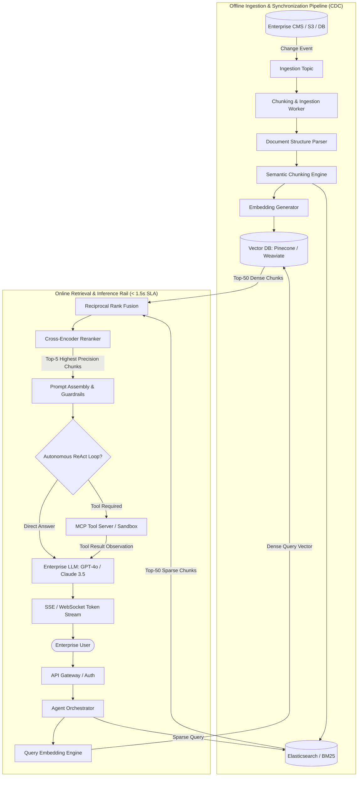

# Enterprise AI Solution Architecture: Hybrid RAG & ReAct Agents

> "A production AI architecture is not a single script.
>
> It is an asynchronous, dual-rail pipeline separating offline continuous document ingestion from online low-latency retrieval, re-ranking, and agent execution."

---

## 1. End-to-End Enterprise Architecture Blueprint



---

## 2. Dual-Stage Retrieval: Why Vector Search Alone Fails

Naïve RAG systems rely exclusively on dense vector similarity search. In production, this breaks down on specific query types:

1. **Exact Identifier Lookups**: Searching for error code `ERR-90214-B` or invoice `INV-2026-991` fails in vector space because embedding models compress arbitrary alphanumeric strings into fuzzy semantic neighborhoods.
2. **Short Keyword Queries**: Searching for `"SLA"` matches hundreds of general policies rather than the specific contractual service level agreement.

### The Solution: Hybrid Search with Reciprocal Rank Fusion (RRF)
We query both a **Lexical BM25 index** (exact keyword matching) and a **Dense HNSW vector index** (semantic intent), then merge the ranked lists using RRF:

$$RRF\_Score(d) = \sum_{m \in M} rac{1}{k + r_m(d)}$$

Where:
- $M$ is the set of rankers (Dense Vector Search, BM25 Lexical Search).
- $r_m(d)$ is the rank of document $d$ in system $m$.
- $k$ is a smoothing constant (typically $60$).

```text
Dense Search Rank:   1. Document B (#1)   2. Document A (#2)   3. Document C (#3)
BM25 Search Rank:    1. Document A (#1)   2. Document D (#2)   3. Document B (#3)

RRF Calculation (k=60):
- Doc A: 1/(60+2) + 1/(60+1) = 0.0161 + 0.0163 = 0.0324  <-- WINNER (Top Hybrid Rank!)
- Doc B: 1/(60+1) + 1/(60+3) = 0.0163 + 0.0158 = 0.0321
```

---

## 3. Two-Stage Pipeline: High Recall $
ightarrow$ High Precision

```text
┌────────────────────────────────────────────────────────────────────────┐
│ STAGE 1: Broad Retrieval (Candidate Generation)                       │
│ - Target: High Recall (Cast a wide net).                               │
│ - Speed: ~30 ms across 10,000,000 document chunks.                    │
│ - Output: Top-50 candidates using HNSW and BM25.                       │
└────────────────────────────────────────────────────────────────────────┘
                                   │
                                   ▼
┌────────────────────────────────────────────────────────────────────────┐
│ STAGE 2: Cross-Encoder Re-Ranking (Precision Filtering)               │
│ - Target: High Precision (Eliminate false positives).                  │
│ - Model: Cross-Encoder (Processes Query and Chunk TOGETHER).           │
│ - Speed: ~100 ms across 50 candidate pairs.                            │
│ - Output: Top-5 gold-standard context chunks for prompt injection.     │
└────────────────────────────────────────────────────────────────────────┘
```
