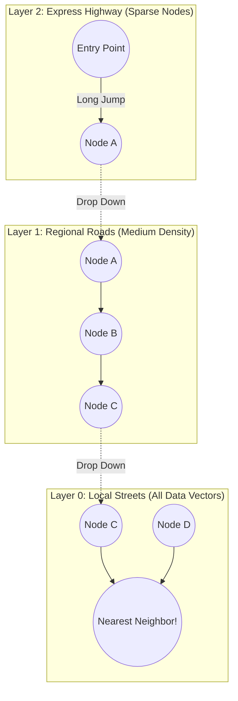

# Vector Embeddings & Similarity Search: Mathematics & Topologies

> "Vectors are high-dimensional points in geometric space.
>
> To search millions of vectors in under 40 milliseconds without exhausting gigabytes of RAM, you must understand distance metrics, graph navigation, and vector quantization."

---

## 1. Vector Distance Metrics: The Mathematical Proofs

Let $\mathbf{u} = [u_1, u_2, \dots, u_d]$ and $\mathbf{v} = [v_1, v_2, \dots, v_d]$ be two $d$-dimensional embedding vectors.

### 1. Cosine Similarity (Directional Alignment)
Measures the cosine of the angle between two vectors, completely independent of their magnitude:

$$	ext{Cosine Similarity}(\mathbf{u}, \mathbf{v}) = rac{\mathbf{u} \cdot \mathbf{v}}{\|\mathbf{u}\| \|\mathbf{v}\|} = rac{\sum_{i=1}^d u_i v_i}{\sqrt{\sum_{i=1}^d u_i^2} \sqrt{\sum_{i=1}^d v_i^2}}$$

- **Range**: $[-1, 1]$ (where $1$ means identical direction, $0$ orthogonal, $-1$ exact opposite).
- **Cosine Distance**: $1 - 	ext{Cosine Similarity}$.
- **Best For**: Text embeddings where document length variations should not distort semantic meaning.

### 2. Dot Product (Inner Product)
Measures both direction and magnitude:

$$\mathbf{u} \cdot \mathbf{v} = \sum_{i=1}^d u_i v_i$$

- **Computational Advantage**: If all vectors are normalized to unit length ($\|\mathbf{u}\| = 1$), **Dot Product is mathematically identical to Cosine Similarity**, but executes **3x faster** on modern CPUs/GPUs because it eliminates the square root and division operations!

### 3. Euclidean Distance ($L_2$ Distance)
Measures the physical geometric distance between two coordinate points:

$$D_{L2}(\mathbf{u}, \mathbf{v}) = \sqrt{\sum_{i=1}^d (u_i - v_i)^2}$$

- **Range**: $[0, \infty)$ (where $0$ means identical points).
- **Best For**: Image embeddings, spatial data, and normalized feature vectors.

---

## 2. Vector Index Topologies: HNSW vs IVFFlat

```text
┌─────────────────────────────────┬──────────────────────────────────┬─────────────────────────────────┐
│ Feature                         │ Flat (Brute-Force kNN)           │ IVFFlat (Inverted File)         │ HNSW (Hierarchical Graph)       │
├─────────────────────────────────┼──────────────────────────────────┼─────────────────────────────────┤
│ Search Complexity               │ $O(N \cdot d)$                   │ $O(rac{N}{K} \cdot d)$        │ $O(\log N \cdot d)$             │
│ Search Latency (1M Vectors)     │ 450 ms (Unusable for OLTP)       │ 18 ms                           │ 4 ms (Gold Standard)            │
│ Index Build Time                │ 0 ms (No index built)            │ Moderate (k-means clustering)   │ High (Graph edge creation)      │
│ Memory Footprint (RAM)          │ Low                              │ Low                             │ High (+20-50% graph overhead)   │
│ Accuracy (Recall@10)            │ 100% (Exact)                     │ 85% - 92% (Approximate)         │ 95% - 99% (Approximate)         │
└─────────────────────────────────┴──────────────────────────────────┴─────────────────────────────────┘
```

### Deep Dive: How HNSW (Hierarchical Navigable Small World) Works
HNSW operates like an algorithmic multi-layer express highway (analogous to a SkipList, but in high-dimensional graph space):



1. **Top Layers**: Contain very few nodes with long-distance edges. The search traverses greedily across sparse nodes to quickly locate the general neighborhood of the query vector.
2. **Lower Layers**: Density increases. The algorithm drops down layer by layer, refining the search radius until it reaches Layer 0.
3. **Layer 0**: Navigates dense local clusters to identify the exact top-$k$ nearest neighbors.

---

## 3. RAM Optimization: Scalar Quantization (SQ) & Product Quantization (PQ)

A 1536-dimensional vector stored as 32-bit floats (`float32`):
$$	ext{Memory per vector} = 1,536 	imes 4 	ext{ bytes} = 6,144 	ext{ bytes} pprox 6 	ext{ KB}$$
For **10 million vectors**, storing raw vectors in RAM requires **60 GB of RAM** just for the coordinates, before index overhead!

### Scalar Quantization (SQ8):
- Compresses each 32-bit float (`float32`) into an 8-bit integer (`uint8`, $[0, 255]$).
- **RAM Reduction**: **75% reduction** (60 GB $
ightarrow$ 15 GB).
- **Recall Impact**: Negligible (<1% drop in recall).

### Product Quantization (PQ):
- Divides the 1536-dimensional vector into $M$ smaller sub-vectors (e.g., 96 sub-vectors of 16 dimensions).
- Clusters the sub-vectors using k-means into 256 centroids and stores only the 1-byte centroid IDs.
- **RAM Reduction**: **95% reduction** (60 GB $
ightarrow$ 3 GB).
- **Trade-off**: Requires re-ranking candidates with full-precision vectors to prevent accuracy degradation.

---

## 4. Vector Database Ecosystem Comparison

| Vector Database | Architecture Model | Distributed Storage | Multi-Tenancy Features | Best Enterprise Fit |
|---|---|---|---|---|
| **Pinecone** | Managed Cloud Serverless | Proprietary Cloud | Namespaces & Metadata filtering | Rapid time-to-market, zero DevOps |
| **Weaviate** | Open-Source & Managed | Modular (HNSW/Disk) | Native Multi-Tenancy partitions | Hybrid search (BM25+Vector) built-in |
| **Qdrant** | Open-Source (Rust) | Native Payload Storage | Tenant filtering, Payload indexes | Ultra-high performance, low RAM footprint|
| **Chroma** | Lightweight Embedded / Svc | DuckDB / ClickHouse | Metadata dictionary filtering | Prototyping, local development, edge |
| **FAISS** | Library (Meta Research) | In-Memory C++ Engine | Manual partition management | Custom high-throughput batch inference |
