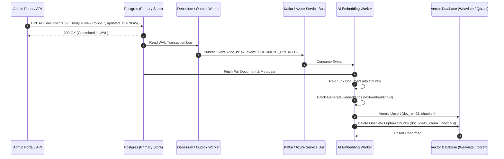

# Production-Grade RAG: Chunking, Ingestion & Hybrid Search

> "Poor chunking destroys the best retrieval engine.
>
> If you slice a sentence in half or disconnect a table row from its column headers, no embedding model in the world can recover the lost semantic meaning."

---

## 1. Document Chunking Strategies

```text
┌──────────────────────────────────┬─────────────────────────────────────────────────────────────┐
│ Chunking Strategy                │ Mechanics & Production Trade-Offs                           │
├──────────────────────────────────┼─────────────────────────────────────────────────────────────┤
│ 1. Fixed-Size Sliding Window     │ Slices text every N tokens with M token overlap.            │
│                                  │ Flaw: Breaks mid-sentence; severs semantic context.         │
│ 2. Recursive Character Chunking  │ Splits hierarchically by paragraph (

), sentence (
),   │
│                                  │ and space. Preserves natural prose structure.               │
│ 3. Semantic Chunking             │ Embeds sequential sentences; calculates cosine distance;    │
│                                  │ splits where semantic topic shift exceeds threshold.        │
│ 4. Hierarchical Document Parser  │ Preserves Markdown headers (H1 -> H2 -> H3), tables, and    │
│                                  │ code blocks. Injects parent header hierarchy into chunks.   │
└──────────────────────────────────┴─────────────────────────────────────────────────────────────┘
```

### The Parent-Document / Context Enrichment Pattern
To ensure the embedding model captures high-level context while providing small, precise chunks to the LLM:

```text
Full Document: "Nova Commerce Enterprise Logistics Master Agreement"
└── Section 4.2: "Late Delivery Indemnification"
    └── Chunk Payload Stored in Vector Database:
        "Context: Nova Commerce Agreement > Section 4.2 Late Delivery
         Text: If shipment exceeds guaranteed delivery SLA by > 4 hours,
         vendor agrees to 15% billing credit applied to invoice."
```
By prepending the structural hierarchy (`Context: Agreement > Section 4.2`), the embedding vector captures the governing topic even when the chunk text is compact.

---

## 2. Real-Time Vector Index Synchronization via Change Data Capture (CDC)

When documents are updated, edited, or deleted in the primary relational database, vector indexes must reflect those changes within seconds to prevent serving stale information:



---

## 3. Production C# Hybrid Search Implementation with RRF

Here is an enterprise-grade hybrid retrieval engine combining dense vector search and BM25 lexical search using Reciprocal Rank Fusion:

```csharp
using System.Net.Http.Json;

public sealed record RetrievedChunk(
    string ChunkId,
    string DocumentId,
    string TenantId,
    string Content,
    double Score
);

public interface IVectorSearchClient
{
    Task<IReadOnlyList<RetrievedChunk>> SearchDenseAsync(
        float[] queryVector, string tenantId, int topK, CancellationToken ct);
}

public interface ILexicalSearchClient
{
    Task<IReadOnlyList<RetrievedChunk>> SearchLexicalAsync(
        string queryText, string tenantId, int topK, CancellationToken ct);
}

public sealed class HybridRetrievalEngine
{
    private readonly IVectorSearchClient _vectorClient;
    private readonly ILexicalSearchClient _lexicalClient;
    private readonly int _rrfKConstant;

    public HybridRetrievalEngine(
        IVectorSearchClient vectorClient, 
        ILexicalSearchClient lexicalClient, 
        int rrfKConstant = 60)
    {
        _vectorClient = vectorClient;
        _lexicalClient = lexicalClient;
        _rrfKConstant = rrfKConstant;
    }

    public async Task<IReadOnlyList<RetrievedChunk>> RetrieveHybridAsync(
        string queryText, 
        float[] queryVector, 
        string tenantId, 
        int topCandidates = 50, 
        CancellationToken ct = default)
    {
        // 1. Parallel Execution: Run Dense Vector Search and Sparse BM25 Search concurrently
        var denseTask = _vectorClient.SearchDenseAsync(queryVector, tenantId, topCandidates, ct);
        var lexicalTask = _lexicalClient.SearchLexicalAsync(queryText, tenantId, topCandidates, ct);

        await Task.WhenAll(denseTask, lexicalTask);

        var denseResults = await denseTask;
        var lexicalResults = await lexicalTask;

        // 2. Reciprocal Rank Fusion (RRF) Accumulator
        var rrfScores = new Dictionary<string, (RetrievedChunk Chunk, double Score)>();

        // Process Dense Ranks
        for (int rank = 0; rank < denseResults.Count; rank++)
        {
            var item = denseResults[rank];
            double rrfScore = 1.0 / (_rrfKConstant + (rank + 1));
            
            if (rrfScores.TryGetValue(item.ChunkId, out var existing))
                rrfScores[item.ChunkId] = (existing.Chunk, existing.Score + rrfScore);
            else
                rrfScores[item.ChunkId] = (item, rrfScore);
        }

        // Process Lexical Ranks
        for (int rank = 0; rank < lexicalResults.Count; rank++)
        {
            var item = lexicalResults[rank];
            double rrfScore = 1.0 / (_rrfKConstant + (rank + 1));

            if (rrfScores.TryGetValue(item.ChunkId, out var existing))
                rrfScores[item.ChunkId] = (existing.Chunk, existing.Score + rrfScore);
            else
                rrfScores[item.ChunkId] = (item, rrfScore);
        }

        // 3. Sort by aggregated RRF score descending
        return rrfScores.Values
            .OrderByDescending(x => x.Score)
            .Take(topCandidates)
            .Select(x => x.Chunk with { Score = x.Score })
            .ToList();
    }
}
```
