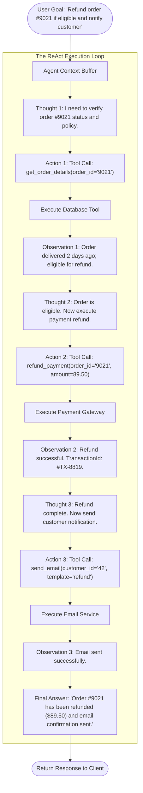

# Autonomous AI Agents & The ReAct (Reasoning + Acting) Execution Loop

> "A prompt is a single-shot function. An agent is a stateful control loop.
>
> An agent possesses a goal, evaluates its environment, plans sequential actions, observes tool execution results, and dynamically corrects course until its objective is satisfied."

---

## 1. Stateless Prompts vs Stateful Agent Loops

```text
┌─────────────────────────────────┬──────────────────────────────────┬─────────────────────────────────┐
│ Dimension                       │ Direct Model Call (Prompt)       │ Autonomous Agent Loop           │
├─────────────────────────────────┼──────────────────────────────────┼─────────────────────────────────┤
│ Execution Topology              │ Request / Response (Linear)      │ Cyclic Control Loop (Feedback)  │
│ Tool Interaction                │ None or Single Function Call     │ Dynamic Multi-Step Tool Chain   │
│ Error Recovery                  │ Fails immediately on bad output  │ Observes tool errors & retries  │
│ State & Memory                  │ Ephemeral (Discarded on return)  │ Stateful execution trajectory   │
│ Decision Autonomy               │ Pre-determined by calling code   │ Model decides next tool to call │
│ Latency Profile                 │ Predictable (~800ms)             │ Variable (2s to 15s)            │
└─────────────────────────────────┴──────────────────────────────────┴─────────────────────────────────┘
```

---

## 2. The ReAct (Reasoning + Acting) Framework

Published by Yao et al. (Princeton / Google Brain), **ReAct** combines chain-of-thought reasoning with real-time environment action execution:



---

## 3. Production C# ReAct Agent Orchestrator

Here is an enterprise-grade ReAct agent loop implementing state trajectories, tool execution sandboxes, and loop-termination guards:

```csharp
using System.Text.Json;

public sealed record ToolDefinition(
    string Name, 
    string Description, 
    Func<string, CancellationToken, Task<string>> ExecuteAsync
);

public sealed record AgentStep(
    string Thought, 
    string? ActionName, 
    string? ActionInput, 
    string? Observation
);

public sealed class ReActAgentOrchestrator
{
    private readonly Dictionary<string, ToolDefinition> _tools = new();
    private readonly ILLMClient _llmClient;
    private readonly int _maxIterations;

    public ReActAgentOrchestrator(ILLMClient llmClient, int maxIterations = 5)
    {
        _llmClient = llmClient;
        _maxIterations = maxIterations;
    }

    public void RegisterTool(ToolDefinition tool) => _tools[tool.Name] = tool;

    public async Task<string> ExecuteGoalAsync(string userGoal, CancellationToken ct = default)
    {
        var trajectory = new List<AgentStep>();
        int iteration = 0;

        while (iteration++ < _maxIterations)
        {
            // 1. Build prompt containing historical Thought -> Action -> Observation trajectory
            string prompt = BuildReActPrompt(userGoal, trajectory);

            // 2. Call LLM to generate next Thought and Action
            string llmOutput = await _llmClient.GenerateAsync(prompt, ct);

            // 3. Parse LLM output for Final Answer or Action
            if (llmOutput.Contains("Final Answer:"))
            {
                return llmOutput.Split("Final Answer:")[1].Trim();
            }

            var (thought, actionName, actionInput) = ParseThoughtAndAction(llmOutput);

            // 4. Invariant: Prevent hallucinated tools
            if (!_tools.TryGetValue(actionName, out var tool))
            {
                trajectory.Add(new AgentStep(thought, actionName, actionInput, 
                    $"Error: Tool '{actionName}' does not exist. Available tools: {string.Join(", ", _tools.Keys)}"));
                continue;
            }

            // 5. Execute Tool with strict timeout
            string observation;
            try
            {
                using var toolCts = CancellationTokenSource.CreateLinkedTokenSource(ct);
                toolCts.CancelAfter(TimeSpan.FromSeconds(5)); // Strict 5s tool timeout
                observation = await tool.ExecuteAsync(actionInput, toolCts.Token);
                
                // Truncate excessively large tool outputs to prevent context overflow
                if (observation.Length > 2000)
                    observation = observation.Substring(0, 2000) + "... [Output truncated to 2000 chars]";
            }
            catch (Exception ex)
            {
                observation = $"Tool execution error: {ex.Message}";
            }

            // 6. Record step in trajectory for next reasoning turn
            trajectory.Add(new AgentStep(thought, actionName, actionInput, observation));
        }

        throw new InvalidOperationException($"Agent exceeded maximum loop iterations ({_maxIterations}) without satisfying goal.");
    }

    private string BuildReActPrompt(string goal, List<AgentStep> trajectory)
    {
        var sb = new System.Text.StringBuilder();
        sb.AppendLine("You are an autonomous enterprise AI agent. Answer the goal using the following tools:");
        foreach (var t in _tools.Values)
            sb.AppendLine($"- {t.Name}: {t.Description}");
        sb.AppendLine("
Format your responses strictly as:");
        sb.AppendLine("Thought: [Reasoning about current state]");
        sb.AppendLine("Action: [ToolName]([ToolInputJson])");
        sb.AppendLine("Observation: [Tool result will be provided]");
        sb.AppendLine("... (repeat Thought/Action/Observation as needed)");
        sb.AppendLine("Thought: I now have enough information to provide the final answer.");
        sb.AppendLine("Final Answer: [Clear, comprehensive answer to user]");
        sb.AppendLine($"
Goal: {goal}
");

        foreach (var step in trajectory)
        {
            sb.AppendLine($"Thought: {step.Thought}");
            sb.AppendLine($"Action: {step.ActionName}({step.ActionInput})");
            sb.AppendLine($"Observation: {step.Observation}");
        }

        return sb.ToString();
    }

    private (string Thought, string ActionName, string ActionInput) ParseThoughtAndAction(string text)
    {
        // Production regex parsing of Thought: and Action: tokens
        string thought = text.Contains("Thought:") ? text.Split("Thought:")[1].Split("Action:")[0].Trim() : "Analyzing state...";
        string actionPart = text.Contains("Action:") ? text.Split("Action:")[1].Trim() : "none";
        
        int openParen = actionPart.IndexOf('(');
        int closeParen = actionPart.LastIndexOf(')');
        
        if (openParen > 0 && closeParen > openParen)
        {
            string name = actionPart.Substring(0, openParen).Trim();
            string input = actionPart.Substring(openParen + 1, closeParen - openParen - 1).Trim();
            return (thought, name, input);
        }

        return (thought, "unknown", "");
    }
}
```

---

## 4. Agent Failure Modes & Defensive Guardrails

### 1. The Infinite Recursive Loop (Ping-Pong Failure)
The agent repeatedly calls `get_inventory_status()` because the output is slightly unexpected, cycling until context tokens are exhausted:
* **Guardrail**: Enforce hard limit $\le 5$ iterations, plus duplicate tool-call detection: if the exact same `(ActionName, ActionInput)` is invoked twice in a row with identical observation, force agent abortion.

### 2. Context Window Exhaustion (Prompt Starvation)
A tool returns a 100,000-character JSON payload (e.g., entire database table dump), causing the next LLM call to exceed token limits:
* **Guardrail**: Enforce mandatory tool output truncation ($\le 2,000$ characters) and summarize bulk data before returning to agent memory.

### 3. Tool Execution Blast Radius
An agent decides to call `delete_database_record(id='*')` due to prompt injection:
* **Guardrail**: Read/Write segregation. Read tools execute autonomously; Write/Mutate tools require **Human-In-The-Loop (HITL) approval tokens**.
