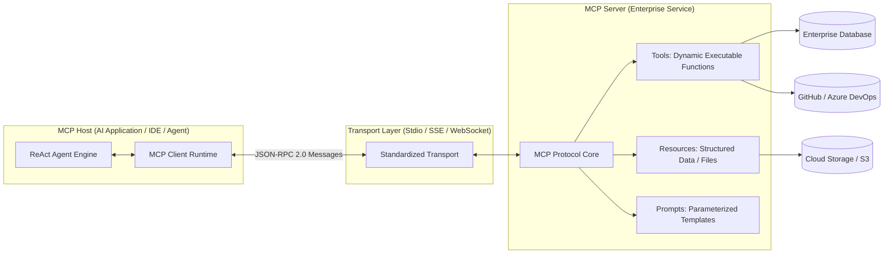

# Model Context Protocol (MCP): Enterprise Architecture & Integration

> "Before MCP, connecting an AI agent to five tools meant writing five custom bespoke SDK integrations.
>
> Model Context Protocol (MCP) is the USB-C of artificial intelligence: an open, standardized protocol decoupling AI clients from external tools, resources, and prompt templates."

---

## 1. The MCP Protocol Architecture

Originated by Anthropic and adopted across the industry, MCP standardizes how AI applications (Hosts/Clients) interact with external systems (Servers):



---

## 2. Core MCP Primitives

MCP defines three distinct, strongly-typed capabilities:

1. **Tools (`tools/list`, `tools/call`)**: Executable functions that allow the LLM to perform actions in external systems (e.g., querying databases, triggering deployments, executing code).
2. **Resources (`resources/list`, `resources/read`)**: Read-only contextual data exposed like a file system (e.g., database schemas, log files, application configurations).
3. **Prompts (`prompts/list`, `prompts/get`)**: Pre-configured prompt templates with dynamic arguments that guide LLMs toward standardized workflows.

---

## 3. Wire-Level JSON-RPC 2.0 Protocol Handshake

### Phase 1: Client Initialization
```json
// Client -> Server
{
  "jsonrpc": "2.0",
  "id": 1,
  "method": "initialize",
  "params": {
    "protocolVersion": "2024-11-05",
    "capabilities": { "roots": { "listChanged": true } },
    "clientInfo": { "name": "NovaEnterpriseAgent", "version": "1.0.0" }
  }
}

// Server -> Client
{
  "jsonrpc": "2.0",
  "id": 1,
  "result": {
    "protocolVersion": "2024-11-05",
    "capabilities": {
      "tools": { "listChanged": true },
      "resources": { "subscribe": true }
    },
    "serverInfo": { "name": "NovaInventoryMCPServer", "version": "2.4.0" }
  }
}
```

### Phase 2: Dynamic Tool Discovery (`tools/list`)
The AI agent queries the MCP server to discover what actions it can execute:

```json
// Client -> Server
{ "jsonrpc": "2.0", "id": 2, "method": "tools/list" }

// Server -> Client
{
  "jsonrpc": "2.0",
  "id": 2,
  "result": {
    "tools": [
      {
        "name": "query_warehouse_stock",
        "description": "Checks physical inventory stock for a SKU across regional warehouses.",
        "inputSchema": {
          "type": "object",
          "properties": {
            "sku": { "type": "string", "description": "Stock Keeping Unit ID" },
            "region": { "type": "string", "enum": ["US-East", "US-West", "EU-Central"] }
          },
          "required": ["sku"]
        }
      }
    ]
  }
}
```

### Phase 3: Tool Execution (`tools/call`)
```json
// Client -> Server
{
  "jsonrpc": "2.0",
  "id": 3,
  "method": "tools/call",
  "params": {
    "name": "query_warehouse_stock",
    "arguments": { "sku": "SKU-9941-X", "region": "US-East" }
  }
}

// Server -> Client
{
  "jsonrpc": "2.0",
  "id": 3,
  "result": {
    "content": [
      {
        "type": "text",
        "text": "{\"sku\":\"SKU-9941-X\",\"available_units\":420,\"reserved\":18}"
      }
    ],
    "isError": false
  }
}
```

---

## 4. Building an MCP Tool Server in C# (.NET 9)

Here is a production-grade MCP Server implementing JSON-RPC 2.0 over standard I/O (Stdio) with structured error handling:

```csharp
using System.Text.Json;
using System.Text.Json.Nodes;

public sealed class McpServer
{
    public async Task RunAsync(CancellationToken ct = default)
    {
        using var reader = new StreamReader(Console.OpenStandardInput());
        using var writer = new StreamWriter(Console.OpenStandardOutput()) { AutoFlush = true };

        while (!ct.IsCancellationRequested)
        {
            string? line = await reader.ReadLineAsync(ct);
            if (string.IsNullOrWhiteSpace(line)) continue;

            var request = JsonNode.Parse(line)?.AsObject();
            if (request == null) continue;

            string method = request["method"]?.GetValue<string>() ?? "";
            var id = request["id"];

            JsonObject response = new JsonObject
            {
                ["jsonrpc"] = "2.0",
                ["id"] = id?.DeepClone()
            };

            switch (method)
            {
                case "initialize":
                    response["result"] = new JsonObject
                    {
                        ["protocolVersion"] = "2024-11-05",
                        ["capabilities"] = new JsonObject { ["tools"] = new JsonObject() },
                        ["serverInfo"] = new JsonObject { ["name"] = "NovaOrdersMcp", ["version"] = "1.0.0" }
                    };
                    break;

                case "tools/list":
                    response["result"] = new JsonObject
                    {
                        ["tools"] = new JsonArray
                        {
                            new JsonObject
                            {
                                ["name"] = "get_order_status",
                                ["description"] = "Retrieves live shipping status for an order.",
                                ["inputSchema"] = new JsonObject
                                {
                                    ["type"] = "object",
                                    ["properties"] = new JsonObject
                                    {
                                        ["order_id"] = new JsonObject { ["type"] = "string" }
                                    },
                                    ["required"] = new JsonArray { "order_id" }
                                }
                            }
                        }
                    };
                    break;

                case "tools/call":
                    string toolName = request["params"]?["name"]?.GetValue<string>() ?? "";
                    var args = request["params"]?["arguments"]?.AsObject();
                    
                    if (toolName == "get_order_status")
                    {
                        string orderId = args?["order_id"]?.GetValue<string>() ?? "unknown";
                        response["result"] = new JsonObject
                        {
                            ["content"] = new JsonArray
                            {
                                new JsonObject
                                {
                                    ["type"] = "text",
                                    ["text"] = $"{{"order_id":"{orderId}","status":"Shipped","carrier":"FedEx"}}"
                                }
                            }
                        };
                    }
                    break;
            }

            await writer.WriteLineAsync(response.ToJsonString());
        }
    }
}
```
