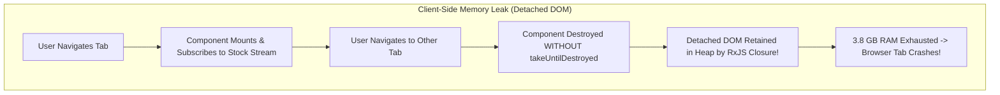

# The Incident: The Memory Leak Freeze & The Cascading Re-Render Cascade

On January 12, 2027, during Nova Commerce's quarterly merchant inventory audit, thousands of enterprise warehouse managers reported catastrophic browser tab freezes across the portal.

Within 20 minutes of navigating between warehouse inventory tabs:
1. **The 3.8 GB Browser Memory Leak**: A single-page application dashboard component subscribed to a continuous WebSocket stock ticker stream using RxJS without unsubscribing on component destruction. Every time a warehouse manager navigated between tabs, new subscriptions piled up in browser heap memory, retaining detached DOM trees and consuming 3.8 GB of client RAM until Chrome crashed with `Error code: Out of Memory`.
2. **The 120 FPS $
ightarrow$ 4 FPS Re-Render Cascade**: In the merchant billing module, an un-memoized object prop passed down a 12-layer component tree triggered the Default change detection algorithm across 4,200 child table rows on every single keystroke. Input latency spiked from 8ms to **1,200ms**, rendering the checkout console completely unusable.
3. **The Multi-Request Token Storm**: An HTTP interceptor caught a 401 Unauthorized token expiry, but failed to queue concurrent outbound requests while refreshing the access token. 80 parallel API calls fired 80 simultaneous refresh requests to the Identity Provider, tripping rate limits and locking out 1,500 active customer service agents.

---

## 1. Root Cause Breakdown

---

## 2. The Principal Engineer Intervention

The Principal Frontend Architect instituted four strict architectural standards:
1. **Mandatory Subscription Lifecycle Governance**: All RxJS subscriptions MUST use `takeUntilDestroyed()` or async pipe (`| async`); bare `.subscribe()` without lifecycle bounds is banned in CI lint rules.
2. **Strict Change Detection Optimization**: All Angular components must declare `ChangeDetectionStrategy.OnPush`; React components must isolate high-frequency state and leverage `React.memo` and immutable state updates.
3. **Queued Token Refresh Interceptor**: HTTP interceptors must use a shared, mutex-protected `BehaviorSubject` to buffer pending requests while a single refresh token operation executes.
4. **Structural Security Directives**: Directives like `*appHasRole` and `*appFeatureFlag` gate UI elements safely at render time without leaking hidden DOM elements.
