# Enterprise HTTP Interceptors: Global Tokens, Queued Refreshes & Error Boundaries

> "An application that manually adds Bearer tokens in every API call is an architectural failure.
>
> HTTP Interceptors establish a centralized pipeline for token injection, 401 refresh coordination, correlation tracking, and RFC 7807 error handling."

---

## 1. The Token Refresh Race Condition (The 401 Storm)

When an access token expires while a user views a dashboard with 10 concurrent widget requests:
- All 10 requests fail simultaneously with `401 Unauthorized`.
- If each interceptor tries to call `/auth/refresh-token`, **10 simultaneous refresh calls fire to the IdP**.
- The IdP's Refresh Token Family detection detects concurrent use of the same refresh token, flags a replay attack, and **revokes the user session completely!**

```mermaid
sequenceDiagram
    autonumber
    participant App as 10 Parallel API Calls
    participant Interceptor as HTTP Interceptor
    participant IdP as Identity Provider

    App->>Interceptor: Request 1..10 (All fail with 401 Unauthorized)
    
    rect rgb(20, 25, 40)
        Note over Interceptor,IdP: Mutex-Protected Queued Refresh
        Interceptor->>IdP: Single POST /auth/refresh-token (Locks Mutex)
        Note over Interceptor: Requests 2..10 are queued in BehaviorSubject!
        IdP-->>Interceptor: 200 OK (New Access Token: Bearer XYZ)
        Interceptor->>Interceptor: Release Mutex & Broadcast New Token to Queue
    end

    Interceptor->>App: Replay Requests 1..10 with New Bearer Token! (All 200 OK)
```



---

## 2. Production Modern Angular Functional Interceptor

In modern Angular (v15+), interceptors are implemented using clean functional pipelines (`HttpInterceptorFn`):

```typescript
import { HttpInterceptorFn, HttpRequest, HttpHandlerFn, HttpErrorResponse } from '@angular/common/http';
import { inject } from '@angular/core';
import { AuthService } from './auth.service';
import { catchError, switchMap, throwError, BehaviorSubject, filter, take } from 'rxjs';

let isRefreshing = false;
const refreshTokenSubject = new BehaviorSubject<string | null>(null);

export const enterpriseAuthInterceptor: HttpInterceptorFn = (req: HttpRequest<unknown>, next: HttpHandlerFn) => {
  const authService = inject(AuthService);
  const token = authService.getAccessToken();

  // 1. Inject Authorization Header if token exists
  let authReq = req;
  if (token) {
    authReq = req.clone({
      setHeaders: {
        Authorization: `Bearer ${token}`,
        'X-Correlation-ID': crypto.randomUUID()
      }
    });
  }

  // 2. Handle Execution and 401 Token Refresh Loop
  return next(authReq).pipe(
    catchError((error: HttpErrorResponse) => {
      if (error.status === 401 && !authReq.url.includes('/auth/refresh')) {
        return handle401Error(authReq, next, authService);
      }
      return throwError(() => error);
    })
  );
};

function handle401Error(req: HttpRequest<unknown>, next: HttpHandlerFn, authService: AuthService) {
  if (!isRefreshing) {
    isRefreshing = true;
    refreshTokenSubject.next(null);

    return authService.refreshAccessToken().pipe(
      switchMap((tokenResponse) => {
        isRefreshing = false;
        refreshTokenSubject.next(tokenResponse.accessToken);
        
        // Retry original request with newly issued token
        return next(req.clone({
          setHeaders: { Authorization: `Bearer ${tokenResponse.accessToken}` }
        }));
      }),
      catchError((err) => {
        isRefreshing = false;
        authService.forceLogout(); // Refresh failed; redirect to login
        return throwError(() => err);
      })
    );
  } else {
    // Subsequent 401 requests wait in queue until new token is emitted:
    return refreshTokenSubject.pipe(
      filter(token => token !== null),
      take(1),
      switchMap(jwt => next(req.clone({
        setHeaders: { Authorization: `Bearer ${jwt}` }
      })))
    );
  }
}
```
