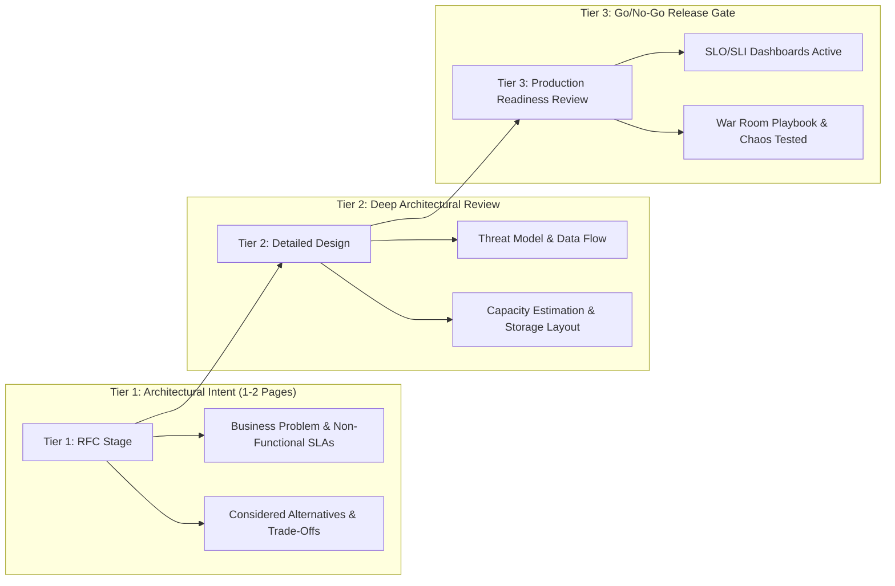

# The Architecture Review Board (ARB) Governance

> "An Architecture Review Board that operates as a bureaucratic rubber stamp creates shadow IT. An ARB that acts as an ivory-tower police force alienates engineering teams.
>
> A Principal-led ARB operates as an advisory accelerator: aligning autonomous delivery squads with enterprise guardrails, financial targets, and long-term technical strategy."

---

## 1. The ARB Charter & Multi-Disciplinary Composition

```text
┌─────────────────────────────────┬─────────────────────────────────────────────────────────────┐
│ Role                            │ Core Review Responsibility                                  │
├─────────────────────────────────┼─────────────────────────────────────────────────────────────┤
│ Principal Software Architect    │ Application boundaries, Clean Architecture, testability     │
│ Principal Infrastructure Lead   │ Cloud topologies, network security, container autoscaling   │
│ Principal Data Architect        │ Data sovereignty, isolation levels, partitioning schemas    │
│ Chief Information Security Off. │ Zero-trust auth, OAuth interactive flows, data encryption   │
│ FinOps / Engineering Director   │ Cloud cost models, licensing overhead, operational budget   │
└─────────────────────────────────┴─────────────────────────────────────────────────────────────┘
```

---

## 2. The 3-Tier Architecture Review Gate


